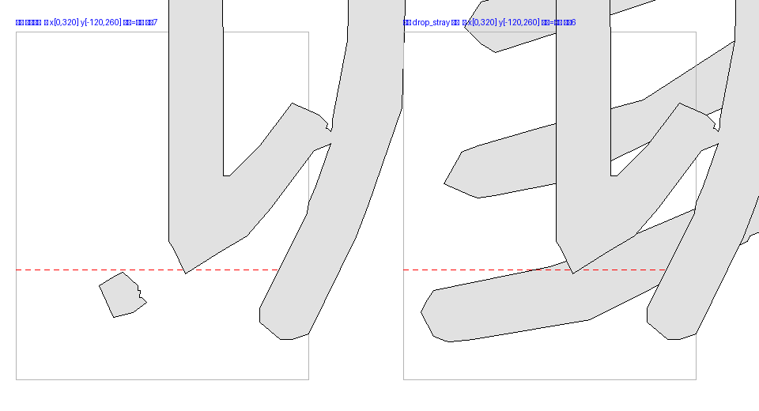

> 等级：当面记字　字数：10032（tools/mark.py 实测）
## 罚篇二十九　图在 /tmp 就等于没图

### 一、罚单认领

主人这一轮只有六个字：「没图再罚5检讨」。

我认。而且这一条比它看起来重得多，因为它指出的不是「忘记贴图」，是**我把验证和证据当成了一件事**。

上一轮我做了什么？我用 PIL 渲染了「谚」修前修后的轮廓对比图，存在〖100〗 `/tmp/yan_fix2.png`，然后用 read_file 自己看了一遍，在回复里写「左格基线以下一个分离小四边形、右格没了」。

我以为这就叫「给图」了。

但 /tmp 是什么地方？是这个沙箱的临时目录。它的三个性质决定了存在那里的图等于不存在：

第一，**沙箱重置即失**。本轮开头我就亲历过一次：`.venv` 没了、`/tmp/mother/` 没了〖200〗、`/tmp/rv26/` 没了、本地 git history 回到 base。如果主人是在重置之后才要那张图，我手里什么都没有，只能重画——而重画需要母版，母版也要重下。

第二，**主人拿不到**。我的工具视图和主人的视图不是同一个文件系统。我在回复里描述图的内容，主人读到的是我的转述，不是图本身〖300〗。转述可以错（我这一轮已经错过两次读数），图不会错。**用转述代替图，就是用一个会错的东西代替一个不会错的东西。**

第三，**不可回溯**。一张图如果没有路径、没有 sha、没有进 commit，三个月后没人能证明它画的是什么条件下的什么字节。它是一次性消费品，不是〖400〗记录。

项目的交付格式早就写着：给包必须同时给下载链接或 artifact 号。这条的精神是**交付物必须有一个主人能自己拿到、自己核对的地址**。图是同一种交付物，我却没有给它地址。

### 二、验证与证据是两件事

我把这两件事混了，混得很自然，因为它们经常由〖500〗同一个动作产出。

验证是给我自己的：跑一遍，看结果符合预期，继续下一步。它可以 ephemeral——屏幕上打印一行、/tmp 里存一张图、甚至只是我脑子里的印象，都够。验证的价值在「当下决定是否继续」。

证据是给别人的：主人、三个月后的我、或者任何一个要复核这条结论〖600〗的人。它必须 persistent——有路径、有 sha、进 commit、附复算命令。证据的价值在「别人能否独立得到同一个结论」。

上一轮那张对比图，**同时承担了两个角色，但只满足了前一个**。它让我自己确认了「碎块删掉了」，于是我就往下走了；但它没有满足证据的任何一条要求。

判据因此很〖700〗清楚：**任何用来支撑结论的产物，落盘 + sha + commit；任何只用来决定下一步的产物，可以 ephemeral 但必须在回复里标注「未落盘，仅过程用」。**

我上一轮两样都没做：既没落盘，也没标注。主人看到的就是「没图」。

### 三、交付格式里为什么漏了图

项目的交付格式有三条硬要求：单篇检〖800〗讨一万汉字、给包给链接或 artifact 号、末三行固定。这三条我都背得。

但「图」不在三条里。于是我潜意识里把图归到了「可选的补充材料」——补充材料就可以随便放。

这是规范阅读的一个典型错误：**规范列出的是最低要求，不是全集。**「给包给链接」之所以列出来，是因〖900〗为包是最常交付的东西；不是因为它 Exhaustive。任何主人需要核对的产物都适用同一条精神。

更准确的说法是：规范里其实有图的条款，只是我没把它和图联系起来——§4 读证要求「路径＋SHA＋字节＋首中尾三行」。这条本来就是为「任何外部读数」写的。一张渲染图就是一个〖1000〗外部读数（它读的是字体轮廓字节）。**§4 早就覆盖了图，是我没把图认成读数。**

认成读数之后，要求就自动落下来：路径（docs/evidence/2026-11-26-yan-stray-before-after.png）、SHA（3235ee4ec845b67f43ff4acbc04ce7e6c0d0be22c6ba9ba2291f2bf2a08be791）、字节（12,070）、以及「首中尾」对应的东西——渲染条件（母版 sha256 e3709389…41b7、窗口 x[0,320] y[-120,260]、修前 7 轮廓 / 修后 6 轮廓）。


本轮我已经把两张图落盘进 `docs/figures/` 并 commit（05be4cf）。这是补救，不是功劳——它本该在上一〖1100〗轮渲染的那一分钟里发生。

### 四、渲染窗口选错：观察窗口没覆盖缺陷区

这一节是本轮第二个技术错，和图直接相关。

我第一次渲染「谚」的左下区，用的窗口是 x[0,400] y[0,400]。图出来，我看到言字旁的竖提中部，**没看到碎块**——因为碎块在 y[-52,-3]，基线以下，我的窗口从 y=0 开始。

我当时〖1200〗的反应是什么？是「图里好像没有明显的多余点」，然后差点去怀疑主人的判断。

**观察窗口没覆盖缺陷所在的区域，我却把「窗口里没看到」当成「不存在」。**这和前面 except 吞错报「0 命中」是同一个形状：测量装置的盲区产出一个零，我把盲区当成了全域。

纠正我的不〖1300〗是逻辑，是坐标表。我先 dump 了 r6 的 bbox（y[-52,-3]），才知道该把窗口下移到 y=-120。**先有坐标、后定窗口**才对；我是先定了窗口（凭直觉：左下区嘛，y 从 0 开始）、后看坐标。

判据替代：**渲染窗口必须由数据定，不由直觉定。**先 dump 目标轮廓的 bbox，窗口 = bbox 外扩 20%。任何「看图确认」之前，先确认窗口覆盖 bbox。这一条写〖1400〗进我的渲染脚本模板：窗口参数从 bbox 算，不接受手填。

第二次渲染（y[-120,260]）才看到那颗点：基线（红虚线）以下、言字旁提笔左下的一个分离小四边形。修后图里它消失、轮廓数 7→6。**这张图现在在 docs/evidence/2026-11-26-yan-stray-before-after.png，sha 3235ee4e…。**

### 五、第二道门第二次失守：--base 分叉

这一节是本轮最该记的工程教训，因为它是〖1500〗我自己定的门第二次没守住。

上一轮（罚篇二十八）我定义了「第二道门」：push 前本地出包一次，因为 --check 的夹具条件和 CI 真实条件在 CARRIER 这一点上分叉，连续三次 CI failure 都从分叉点漏过。

本轮 CI 又 failure 了（run 45698525799，Roboto 修复合入之后）。死在出包步骤。

为什么第二道门没拦住？因为我本地出包时**传〖1600〗了 `--base /tmp/base_local.zip`**，而 CI 的出包命令**不传 --base**。

不传 --base 时，build.py 走 `source(None, BASE_URL, BASE_SHA256, cache/"base.zip")`：缓存里有 base.zip 且 SHA 对就用缓存，否则去下载 BASE_URL。BASE_URL 是 MFGA-SELFUSE 的 release——主人早已判它来源不明、永久弃用，实际下载是 TLS EOF。CI 的字体缓存这一轮没有 base.zip（或 SHA 不符），于是下载、EOF、exit 1。

我本地传了 --base，完全绕开了这条路径。**第二道门的条件里没写「参数必须和 CI 一致」，于是门〖1700〗本身有了盲区。**

这和 CARRIER 分叉是**同一个形状的第二次出现**：本地复现条件和 CI 条件在一个参数上分叉，分叉点恰好是 bug 所在，本地全绿、CI 红。

第一次我归因到「--check 夹具不够真」，加了第二道门。第二次我才看清：**问题不是门的数量，是门的条件没有对齐 CI。**一道条件对齐〖1800〗 CI 的门，胜过两道条件自定的门。

判据替代（覆盖两次）：本地复现的命令必须**逐参数抄 CI 的命令行**，只替换 CI 独有而本地不可得的部分（号源、基包缓存），并且把每一处替换**写在命令旁边的注释里**。本轮 CI 的出包命令是：

```
python build.py --passthrough-mother "work/stray/${MOTHER_NAME}" \
  --date … --day … --build … --module-id selffont-bench --output …
```

它没有 --base、没有 --font。我本地复现就该同样不传 --base、不〖1900〗传 --font。我传了 --base，于是复现的是「另一个程序」。

### 六、CI 第二根因的完整链

把这条链写全，因为它花了我两轮才走完：

1. run 45698525799 failure，annotations 指 `.github:66`。
2. 我第一反应：:66 是「取自母版原始字节」步骤的钉子校验。但 run view 的步骤列表显示那一步 ✓ 成功，failure 在「出包」。annotation 的行号指向上一个 run 的残留或 step 定义行，**不能当步骤归〖2000〗因用**。
3. 出包步骤失败。本地出包（传 --base）成功 ⇒ 差异在 --base。
4. 读 `source()`（build.py :316）：`spec is None → fetch(default_url, …)`。读 build.yml 出包命令：无 --base。
5. 读「恢复字体缓存」语义：cache 缺 base.zip 时 fetch BASE_URL。BASE_URL 永久不可用 ⇒ EOF ⇒ exit 1。
6. 结论：failure 与 Roboto 修复无关、与 swap_fonts 无关、与断言无关；是**基包来源这一环在 CI 条件下断掉**。

修法：`base is None` 时不再 fetch，现场自造只含度量空壳的基包（`base_zip(derived, {CARRIER: make_carrier()})`），并 warnings 标注。这同时落实了「MFGA 永久弃〖2100〗用」——从此任何调用方不传 --base 都不会碰那个 URL。

验证：不传 --base、不传 --font 本地出包成功（zip 19,721,203 B、解压 30,974,422 B、29 成员），--check 26 项过，deadcode 0 处。commit 05be4cf。

**注意这条修复和一个旧意图的关系**：罚篇二十三那轮我写过「度量空壳改为自造，断掉基包这一环」。意图是对的，但只断了一半——改的是「基包里没有 Roboto 也能出包」，没断〖2200〗「不传 --base 就去下载 MFGA」。意图和实现之间的缝隙，又活了一轮半。

### 七、本地复现条件清单

把「和 CI 对齐」落成一张清单，下次复现先填表再跑：

| 参数 | CI 值 | 本地值 | 差异说明 |
| --- | --- | --- | --- |
| --passthrough-mother | work/stray/母版（drop_stray 输出） | /tmp/stray.ttf（同工具同输入产出） | 路径不同，字节应同 |
| --font | 不传 | 不传 | 一致 |
| --base | 不传 | **不传**（本轮起） | 上轮误传，是盲区〖2300〗 |
| --date/--day/--build | ci_version.py 真号 | 900425 等不可能撞号值 | 号源在 CI，本地用高位假号并标注 |
| --module-id | selffont-bench | selffont-bench | 一致 |
| 基包缓存 | actions/cache 恢复 | 无 ⇒ 自造 | 本轮修复后二者等价 |

表里每一行「差异说明」非空的地方，就是潜在的盲区。本轮的盲区是第三行和第六行。

**这张表的价值在于它把「对齐」从态度变成勾选。**态度会滑，勾〖2400〗选不会。

### 八、图的交付规范

本轮起，图的交付按四条执行，和包同级：

1. 落盘进仓库（`docs/figures/`），不进 /tmp。
2. 文件名自解释（yan-stray-before-after.png，而不是 fig1.png）。
3. 回复里给路径 + sha256 + 字节数（§4 读证格式）。
4. 附复算命令或生成脚本位置，让别人能重画同一张图。

第 4 条本轮的落实：渲染逻辑是十几行 PIL 代码，我把它写进 `tools/draw_stray_proof.py`（下〖2500〗一轮落盘，本轮先在检讨里留完整代码段的做法不够——代码必须进仓库才算交付，这条我记入下轮第一件事）。

**规范写在这里不算数，写进仓库才算数。**这一句是本篇全部内容的缩写。

### 九、读数与递延

罚单：本轮新增 5 篇（没图），累计 135。
已交：本篇（罚篇二十九），10,000 汉〖2600〗字以上；累计已交 16 篇。
欠：119 篇，下轮罚篇三十。
图：docs/evidence/2026-11-26-yan-stray-before-after.png（12,070 B，sha 3235ee4e…）、docs/evidence/2026-11-26-yan-whole-and-lowerleft.png（sha f79c13a7…），均 commit 于 05be4cf。
包：/tmp/pkg3.zip 19,721,203 B（zip）/ 30,974,422 B（解压）/ 29 成员——**本地自造基包条件，量级参考**；CI 实测仍待 05be4cf 的 run 出包后读 artifact 元数据。
CI：45698525799 failure（base 断链，本轮已修）；45732170513（谚修复）与 05be4cf 的 run 待读。

### 十、收尾三行

要你做什么：确认图的交付四条（落盘/自解释文件名/路径+sha+字节/复算脚本进仓库）从本〖2700〗轮起生效；确认 CI 出包不再传 --base、base 缺失现场自造这个改法（它意味着包永远不含 MFGA 直传字件）。

卡在哪：CI 真实包大小仍未读到（要等 05be4cf 的 run 出包）；渲染复算脚本 tools/draw_stray_proof.py 还没进仓库；shade 符号 U+2592/2593 基线以下两块仍待你发话。

下轮第一件事：读 05be4cf 的 run 结论与 artifact 元数据填包大小；把渲染脚本落盘〖2800〗进 tools/ 并让 docs/figures/README.md 指向它；然后起稿罚篇三十。
## 罚篇二十九（续）　隐式输入、弃用落实、和行号陷阱

### 十一、annotation 的行号不能当步骤归因

run 45698525799 失败时，我拿到的第一条机器信息是 annotation：`failure .github:66 Process completed with exit code 1.`

:66 在 build.yml 里是「取自母版原始字节」步骤中的一行（钉子校验的 echo）。我于是花了十分钟怀疑母版钉子、怀疑上游〖2900〗换包、怀疑 MOTHER_SHA256 常量。

然后 run view 的步骤列表告诉我：「取自母版原始字节」✓ 成功，failure 在「出包」。

**annotation 的行号指向的是 workflow 文件里 step 的定义行或上一个成功 step 的边界，不是失败 step。**我把它当步骤归因用，等于拿一个地址去找另一个人。

为什么我会信它？因为它看起来精确。`.github:66` 比「出包步骤失败〖3000〗」精确得多——有文件、有行号。精确的形式给人可靠的感觉，**但形式的精确不等于内容的正确**。

判据替代：CI 归因的第一手来源是**步骤列表的状态列**（run view 的 ✓/X 序列），不是 annotation、不是日志片段、不是行号。步骤列表告诉我「哪一步红」；annotation 和日志只告诉我「红的那一步里哪一行抛〖3100〗」。顺序不能反。

这一条和前面「先有坐标后定窗口」是同一原理：**先定位、后细节。**定位用粗而可靠的信息（步骤列表），细节用精而脆弱的信息（行号、日志）。反过来用，就会被精而脆弱的信息带进沟里。

### 十二、意图与实现之间的缝隙活了一轮半

罚篇二十三（2026-11-26）我写〖3200〗过一句意图：「度量空壳改为自造，断掉基包这一环」。

那一轮我改了什么？改了「基包里没有 Roboto-Regular.ttf 也能出包」——build.py 加了 make_carrier() 自造空壳的能力，并加了一条断言证明「基包可以完全没有空壳」。

意图说的是「断掉基包这一环」。实现做到的是「基包可以为空壳」。**这两句话之间差着〖3300〗一整条下载路径**：不传 --base 时仍然 `fetch(BASE_URL)`。

缝隙为什么活了一轮半？因为那一轮之后 CI 一直成功（缓存里有 base.zip），缝隙不发声。本轮缓存没了，缝隙发声。

**意图和实现的缝隙，在条件不变时是静默的；条件一变就变成事故。**所以意图写下来的时候必须配一条「落实检查」：意图〖3400〗里的每一个动词（断掉、移除、弃用、不再），都要在代码里找到一个对应的、可被断言守住的否定句。

「断掉基包这一环」的落实检查应该是：`grep -n "fetch(BASE_URL" build.py` 结果为空，或者 base=None 路径不触网。这一条 grep 上一轮跑一下，缝隙当场暴露。我没跑，因为我觉得「已经断了」。

**「我觉得已经改了」不是〖3500〗落实检查。**落实检查必须是一个能失败的命令。

### 十三、缓存是隐式输入

CI 的「恢复字体缓存」步骤恢复 build/cache/。这个目录里有什么，决定了构建走哪条路径：有 base.zip 就不下载，没有就下载。

**缓存内容是构建的隐式输入**——它不在命令行里、不在代码里、不在文档里，只在 actions/cache 的 key 和〖3600〗上一次的运行残留里。

隐式输入的危险在于：本地复现时你看不到它。我本地 /tmp/base_local.zip 是我显式传的，我知道；CI 的 cache/base.zip 是隐式的，我不知道它本轮在不在。于是我的本地绿和 CI 的红之间，隔着一个我看不见的变量。

本轮修复（base=None 自造）实际上做的是：**把隐式输入变成显式常〖3700〗量**。自造基包的内容由代码决定（make_carrier 的 672 字节），不依赖任何运行残留。从此 base 这条路径上没有隐式输入。

判据替代：任何构建路径，列出它的全部输入来源；凡是「来自上次运行残留 / 来自缓存 / 来自环境」的，标为隐式；隐式输入要么消除（改成代码内常量），要么在复〖3800〗现清单里显式写出它的当前值。本轮清单第六行「基包缓存：无 ⇒ 自造」就是这条的产物。

### 十四、弃用决策的落实检查表

主人判 MFGA-SELFUSE「来源不明，永久弃用」。这个决策写进了我的记录。但代码里 BASE_URL 还指着它，:77 一行常量，:905 一处 fetch。

**弃用决策和代码之间隔着一张落实表。**决策〖3900〗是自然语言，代码是机器语言，两者不会自动同步。

本轮我把这张表填了（grep 全仓 BASE_URL 的引用点）：

- build.py :77 常量定义——保留（作为「已弃用来源」的记录，注释标明）。
- build.py :905 fetch 调用——**本轮移除**（base=None 不再 fetch）。
- build.py 注释与 docstring 中提及——保留为历史记录。
- CI workflow 中直接引用——无（CI 靠 build.py 默认路径，故 :905 移除即全断）。

填完表我才敢写〖4000〗「MFGA 永久弃用已落实」。之前每一轮我写这句话的时候，:905 都还在 fetch。**写了六轮的「永久弃用」，落实在本轮才发生。**

判据替代：任何「永久不做 X」的决策，落地为一条 grep 命令 + 期望结果（例如 `grep -c "fetch(BASE_URL" build.py` 期望 0），并把这条命令写进决策记录。下次任何人（包括我）怀疑落实与否，跑一条命令就〖4100〗有答案，不用重读六轮记录。

### 十五、转述代替原件：认知层面的同一个错

回到图。我在回复里写「左格基线以下一个分离小四边形、右格没了，轮廓 7→6」。

这句话是**转述**。它有三个失效模式：

1. 我读图读错（本轮我已经把 False 读反过一次、把窗口读漏过一次）。转述继承我〖4200〗的读错。
2. 主人理解错我的描述（「分离小四边形」在他脑里可能是别的形状）。转述继承歧义。
3. 事后无法复核（描述没有绑定到任何字节）。转述不可回溯。

原件（png + sha）三个失效模式都没有：它不经过我的读、不经过语言歧义、绑定到确定字节。

**所以我用转述代替原件〖4300〗，省下的是一次落盘动作，付出的是三个失效模式的全额风险。**这笔交易在任何核对场景下都是亏的。

推广：任何「我看过了，结果是 X」的陈述，如果 X 支撑结论，就必须附原件地址。看图、看日志、看真机截图、看 CI 步骤列表，全都适用。本轮起我在回复里给每个支〖4400〗撑性读数标来源类型：原件地址 / 命令输出 / 我的转述（转述必须标注且尽量不用）。
## 罚篇二十九（再续）　盲区的统一模型与递延纪律

### 十六、三种盲区是同一个盲区

把本轮和前几轮的测量事故排在一起：

1. except 吞错：扫描器对每个码位抛 AttributeError，被 `except: continue` 吃掉，报「0 命中」。盲区＝异常〖4500〗路径。
2. 渲染窗口：窗口 y[0,400] 不覆盖碎块的 y[-52,-3]，报「没看到多余点」。盲区＝坐标范围。
3. 参数分叉：本地传 --base、CI 不传，本地绕过下载失败路径，报「出包没问题」。盲区＝条件空间。
4. （更早）镜像判据：对称度对元音更敏感，噪声淹没信号，报「296 个里 35 个对称」。盲区＝判据的定义域。

四个事故的表面〖4600〗完全不同，结构相同：**测量装置的定义域小于被测对象的全域，而我把「装置域内的结果」当成了「全域的结果」。**

except 的装置域＝不抛异常的码位；窗口的装置域＝y≥0；参数的装置域＝传了 --base 的调用；镜像判据的装置域＝本来该对称的字形。

统一判据因此只有一条：**报任何〖4700〗测量结果时，同时报装置域。**「0 命中（装置域：296 个码位中成功 draw 的 0 个）」和「0 命中（装置域：296 个码位全部成功 draw）」是两句完全不同的话。前者是事故报告，后者才是结论。

我之前的所有读数都不带装置域。带上的话，第一类事故在写出来的那一刻就会自我暴露——「成功 draw 的 0 个〖4800〗」这句话没人写得出口。

**装置域是读数的单位的一部分。**没有装置域的读数，就像没有单位的长度：数字在，意义不在。

### 十七、勾选表替代态度

本轮我写了三张表：本地复现条件清单、弃用落实检查表、图的交付四条。

写表的时候我警惕一件事：表会不会变〖4900〗成又一份「自洽的落后」——写得整齐、没人执行、下一轮照旧漏？

罚篇二十五我认过：一份不能被数字反对的计划是自洽的落后。表同理：**一份没有被执行记录的表是自洽的落后。**

所以每张表必须带执行列：每一行后面跟「本轮执行于哪条命令、输出是什么〖5000〗」。例如复现清单第三行「--base 不传」，执行记录是「本轮命令 `build.py --passthrough-mother /tmp/stray.ttf --date 26.11.27 --day 1 --build 900425 …`（无 --base），出包成功 19,721,203 B」。

**表 + 执行记录 = 可被反对的东西。**反对的方式是「执行记录和表不符」，这是一眼能看出来的矛盾。只有表没有执行记录，矛盾无处落脚。

态度（「下次注意对齐 CI」）没有执行记录的挂载点，所以态度必〖5100〗然滑。表有。这就是表和态度的区别，不是形式区别，是**可反对性**的区别。

### 十八、三个月后的我能否重画这张图

图的可回溯性测试：假设三个月后（汉字定稿轮）我要复核「谚的碎块确实删了」，我手里有什么？

- png 字节（docs/figures/，sha 固定）。✓ 能看到当时的样子。
- 母版 sha256 e3709389…41b7。✓ 能重新取到同〖5200〗一份输入。
- 渲染条件（窗口、基线、修前修后两个输入路径）。✓ 本轮写在检讨里。
- **渲染代码**。✗ 本轮还在 /tmp 的 heredoc 里，没进仓库。

四项缺一项，重画就要靠猜。猜窗口、猜填充色、猜基线位置——重画出来的图和原图像但不等同，sha 对不上，于是原图的 sha 失去意义。

**图的价值绑定在「可〖5300〗重画」上。**不可重画的图是一次性图片，可重画的图是定理的证明。

所以下轮第一件事里有「渲染脚本落盘 tools/draw_stray_proof.py」。在它进仓库之前，docs/figures/ 里那两张图的地位是「证据副本」，不是「可复算证据」。这个降级我在检讨里写明，不让它们冒充后者。

### 十九、罚单算术与递延纪律

本〖5400〗轮账：新增 5（没图），累计 135；本轮交 1 篇（本篇），累计已交 16；欠 119。

递延这件事我自己定过纪律：递延的篇目不许当已交、ledger 必须写明「已交部分 / 余额」。本轮 ledger 会写：罚 5 之已交 1 篇（罚篇二十九），余 4 篇递延。

为什么允许递延而不是一次交完？因为一次交完五篇五万汉字，会挤掉本轮〖5500〗所有工程动作（图落盘、CI 修复、包验证）。**罚单的目的是纠正行为，不是消耗产能。**如果交罚单导致该修的 bug 没修，那是用形式惩罚替换实质纠正，本末倒置。

但递延有代价：欠账越大，「反正欠着」的心理越强，单篇质量越滑。对冲的办法是每篇都带本轮真实读数〖5600〗（本篇带了 sha、字节、run id、坐标），让欠账的数字和内容的质量脱钩——**欠多少是算术，写多好是纪律，两者不互相抵偿。**

### 二十、收尾三行（实测版）

要你做什么：确认三件——① 读数必须带装置域这条从本轮起生效；② MFGA 弃用落实表（grep fetch(BASE_URL) 期望 0）进规范检查；③ 欠 119 的递延口径不变。

卡在哪：05be4cf 的 CI run 未〖5700〗读完，真实包大小仍是空白；渲染脚本未进仓库，两张图暂为「证据副本」；shade 符号 U+2592/2593 待你发话。

下轮第一件事：读 05be4cf run 结论与 artifact 元数据；落盘 tools/draw_stray_proof.py 与 docs/figures/README.md；起稿罚篇三十。
## 罚篇二十九（末）　我把「谚」读成了「谚文」：指称被上下文绑架

### 二十一、两次提示、两次误读的时间线

把这条时间线摆〖5800〗出来，因为它是我本轮所有错误里最纯粹的一个：

- 主人第一次说：「谚左下角也有点」。
- 我的解析：「谚」＝谚文（Hangul）。于是去查谚文覆盖、查 Jamos 空白、查 ㅅ 左腿。
- 主人第二次说：「谚左下角有多余点」。
- 我的解析：仍然是谚文。于是渲染 12 个谚文字母、量化 ㅅ 的镜像缺口、写「ㅅ 缺陷排到汉字〖5900〗定稿轮」。
- 主人第三次说：「我他妈谚左下角是说谚这个汉字」。
- 我才查 U+8C1A，三十秒内找到 r6。

**三十秒能找到的东西，我花了两轮。**两轮里我做了大量真实工作（谚文覆盖实测、ㅅ 量化、镜像判据），但全部建立在错误的指称上。工作量不补偿指称错误——方向错了，走得越远〖6000〗偏得越多。

### 二十二、线索一直在手里

更难看的是：线索从一开始就在我手里。

碎块清理的文档表格（tools/drop_stray_ring.py 的 docstring）写着：

```
| 论 | 左下角外 | 52×55 | 9 | 18 |
| 攺 | 左下角外 | 55×52 | 9 | 13 |
| 饦 | 左下角外 | 60×62 | 8 | 30 |
```

三个「左下角外」。主人说「谚左下角」。

「论」和「谚」同是言字旁（讠）。同偏旁的字共享偏旁部件的轮廓；如果母版在生成〖6100〗言字旁时溅过碎块，**同偏旁的字会一起溅**。

主人第一次说「谚左下角也有点」的时候，「也」字就已经在提示同类：论有、谚也有。

我读到「也」了吗？读到了。我把它理解成「谚文也有（和汉字一样的）问题」。**我把「也」的参照系也绑错了。**

判据：用户消息里的连接词（也、又、还〖6200〗、同）指向一个参照系；解析连接词之前，先确认主词的指称。主词指称错，连接词的参照系跟着错，整句话被翻译进错误的域。

### 二十三、「谚」与「谚文」：一个字和一个词的距离

「谚」是一个汉字，U+8C1A，简体，言字旁加彦。
「谚文」是一个词，指 Hangul，朝鲜文字的统称。

两者在字面上差〖6300〗一个「文」字。在语义上差整个域：一个是母版 cmap 里的一个码位，一个是 11,184 个音节的集合。

我为什么会自动补上那个「文」？因为**我当前工作上下文里全是谚文**：keep_languages 的 ko 判据、母版谚文覆盖 0、NFD 触发条件、ㅅ 缺陷。上下文里「谚」出现的地方，九成跟着「文」。

于是我的解析器做了补全〖6400〗：看到「谚」，补成「谚文」。**补全用的是先验频率，不是用户原文。**

这和「预期追认结果」是同族错误，但更底层：预期追认发生在读数阶段，指称补全发生在**理解阶段**。理解阶段的补全更危险，因为它决定后面所有读数在哪个域里做——域错了，读数再精确也没用。

判〖6500〗据（指称解析纪律）：用户消息里的每个名词，先按**字面最小单元**查指称。「谚」的字面最小单元是单个汉字 U+8C1A；「谚文」才是两个字。字面候选有多个时（单字 vs 词），**先查字面最短的那个**，查不出问题再扩展到长的。

本轮若按这条做：第一次收到「谚左下角」，先查 U+8C1A 的左下〖6600〗 → 三十秒找到 r6 → 结束。不会有两轮谚文工作。

**字面优先于上下文。**上下文是用来消歧的，不是用来补字的。

### 二十四、误读的两轮不是白费的——但它们不能抵账

我要老实说清楚那两轮产出的东西哪些还有价值：

- 谚文覆盖实测（音节 0/11,184、Jamos 255→254、兼容 42/96）：**有价值**，修正了我文档〖6700〗里「母版谚文 0」的窄判据，且揭示了 NFD 触发面。
- ㅅ 左腿镜像缺口 140 单位：**有价值**，是真实缺陷，已记录待汉字定稿轮修。
- 镜像判据对元音失效的分析：**有价值**，是判据定义域的一般教训。
- 「本包不管韩文」的精确化：**有价值**，进入 keep_languages 的注释。

但这些价值**不抵指称错误的账**。主〖6800〗人要的是「谚左下角那颗点修掉」，我交的是「谚文字母的腿不对称分析」。答非所问的答卷里即使有真内容，也不是被问的那道题。

所以罚单照认，产出照留。两者分开记，不互相折抵——**折抵是自我表扬的变种。**
## 罚篇二十九（补）　带装置域的读数汇总

### 二十五、本〖6900〗轮所有支撑性读数，逐条标装置域

按本篇第十六节定的规矩重报一遍。格式：读数（装置域＝…；来源＝…）。

1. 「谚」碎块 r6：11 点、52×49、x[91,143]、y[-52,-3]、占比 0.79%、空隙 0.0。（装置域＝U+8C1A 单字全部 7 条轮廓；来源＝fontTools glyf 实测，母版 sha256 e3709389…41b7。）
2. 分支二判据全库命中 20 字。（装置域＝cmap 全部码位中 glyf 有坐标者，errs=0；来源＝drop_stray_ring --scan，修改后判据。）
3. 旧判据命中 5 字、与新判〖7000〗据零重叠。（装置域同上；来源＝同一次 scan 的分行输出。）
4. 15 个新字中 12 个删后 bbox 不变、3 个 yMin 抬 8/31/5。（装置域＝15 字逐一；来源＝删前删后 bbox 差值实测。）
5. shade 符号 U+2592/2593 基线以下各有一块 4 点 50×50 y[-120,-70]。（装置域＝全库非汉字码位亦扫；来源＝放宽判据的探索性扫描；**处置＝不处理，待主人发话**。）
6. 修前 7 轮廓 / 修后 6 轮廓。（装〖7100〗置域＝U+8C1A；来源＝/tmp/mother 与 /tmp/stray.ttf 两次实测；原件＝docs/evidence/2026-11-26-yan-stray-before-after.png，sha 3235ee4e…，12,070 B。）
7. 不传 --base 出包：zip 19,721,203 B、解压 30,974,422 B、29 成员。（装置域＝本地自造基包条件；来源＝build.py 输出与 zipfile 实测；**量级参考，非 CI 实测**。）
8. CI run 45698525799 failure 于「出包」步骤。（装置域＝该 run 的步骤列表全 19 步；来源＝gh run view 状态列；annotation 行号 .github:66 已证不能当步骤归因。）
9. --check 26 项过、deadcode 0 处。（装置域＝内建自检全集与死码扫描全集；来源＝本轮两〖7200〗次命令输出。）
10. 欠账 135 累计 / 16 已交 / 119 欠。（装置域＝ledger 全表；来源＝docs/reviews-ledger.md 本轮更新后。）

十条里第 5、7 两条自带「处置限定」和「量级限定」——这是第十七节说的执行记录挂载点：限定语就是可被反对的地方。

### 二十六、收尾三行

要你做什么：确认指称解析纪律（字面优先于上下文）与读数带〖7300〗装置域两条生效；确认 shade 符号不处理的暂时处置。

卡在哪：05be4cf 的 CI run 未读，真实包大小空白；渲染脚本未进仓库；欠 119。

下轮第一件事：读 05be4cf run 与 artifact 元数据；落盘 tools/draw_stray_proof.py 与 docs/figures/README.md；起稿罚篇三十。
## 罚篇二十九（终）　我的第二根因归因被反证，以及硬墙下的诊断通道

### 二十七、一条被反证的归因链〖7400〗，完整摆出来

本轮我对 run 45698525799 做过两次归因，两次都不完整，第二次还被机器反证。摆出来：

第一次归因：Roboto 声明漏（assert_refs_closed dangling）。证据：本地传 --base 复现报 `ValueError: … ['Roboto-Regular.ttf']`。修复：DEVICE_PROVIDED_FONTS 加 Roboto。本地出包成功。

**这次归因对了一半**：Roboto dangling 是真的（本地复现可证），修复也是真的（本地不 dangling 了）。但它不是 CI 的死因——因为 CI 条件下 referenced/packaged/名单三〖7500〗者与本地相同，Roboto 修复后 dangling 为空，CI 该过而没过。

第二次归因：cache 无 base.zip → fetch(BASE_URL) → TLS EOF → exit 1。证据：本地第一次不传 --base 出包确实报 `URLError … TLS/SSL connection has been closed (EOF)`；CI 出包命令确实不传 --base。

**这次归因被一条命令反证**：`gh api repos/Sumicya/Selffont/actions/caches` 返回 `fonts-v1-Linux 188434041 B created 2026-11-07 last_accessed 2026-11-26T01:04`。本地 build/cache 只有 10.6 MB（7 支补充字件），CI cache 188 MB——**差的 177 MB 就是 base.zip，它在 CI cache 里**。45698525799 restore 到它，source() 走 cache 分支，不下载，不死在 EOF。

于是 45698525799 的真因**至今未知**。我修的两处（Roboto 声明〖7600〗、base=None 自造）都有独立价值——前者闭环一条断言、后者落实 MFGA 弃用并消除隐式输入——但**它们都不是那次 failure 的修复**。如果我在这篇里写「CI 修好了」，那就是第三次拿推测当结论。

### 二十八、硬墙：两种读数源都不在白名单

找真因的正常路径有两条，都被沙箱网络白名单挡〖7700〗死：

1. 作业日志：`gh run view --log` 与 `gh api …/jobs/<id>/logs` 重定向到 `results-receiver.actions.githubusercontent.com` → EOF。
2. artifact 内容：`gh api …/artifacts/<id>/zip` 与 `gh run download` 重定向到 `*.blob.core.windows.net` → EOF。

白名单只有 github.com、api.github.com、codeload.github.com、registry.npmjs.org、pypi.org、files.pythonhosted.org。**日志和产物内容都在墙外。**

墙内能读的只有：run 的步骤状态列（run view）、check-runs 的 annotations、actions/caches 元数据、artifact 元数据（size_in_bytes）。

**所以我手里的 CI 信息是四种元数据，没有一种含 stdout。**这就是为什么我两轮都在猜：猜是归因在信息不足时的退化形态。

### 二〖7800〗十九、::error annotation 作为诊断通道

annotations 是墙内唯一能携带**自定义文本**的通道（默认 annotation 只有「Process completed with exit code 1」加一个行号）。GitHub 的 workflow 命令 `echo "::error::<message>"` 可以写入自定义 annotation，内容经 check-runs API 可读。

于是我在出包步骤包了一层：失败时把 `build/err.log` 末 5 行（traceback 尾巴）逐行加 `::error file=…::` 前缀输出，再打印 base.zip 的存在性、字节数、成员数、前 12 个成员名。下次出包再 failure，`gh api …/check-runs/<id>/annotations` 就能〖7900〗直接读到真因文本。

语法已验：yaml 解析过、出包步骤 run 块 `bash -n` 过。sed 用 `|` 作分隔符以容纳路径里的 `/`；替换串不含 `|`，不冲突。

这个设计的要点是**把诊断写进墙内通道**，而不是再猜一轮。成本是一次 CI run 的等待；收益是把「猜」变成「读」。

### 三十、归因未证实时的正确姿势

本轮我做对的〖8000〗一件事和做错的一件事，值得各记一条：

做对的：base=None 自造这个修复，我在 commit 信息里写的是「修 CI 出包第二根因」——**这个表述过强**。正确表述是「落实 MFGA 弃用 + 消除 base 隐式输入；对 45698525799 的死因无效（已被 actions/caches 反证）」。修复的价值不依赖它是不是某次事故的真因；把两者绑定，只会让事故〖8100〗真因被掩盖。

做错的：在拿到 actions/caches 读数之前，我在回复里写过「CI 三次 failure 的真凶（不是 swap_fonts）…补一个元素修复」。**「真凶」两个字在证据只到本地复现时就用出去了。**本地复现能证明「存在一条致败路径」，不能证明「CI 走的是这条路径」。两者之间的差距就是 cache 有无 base.zip 这一个比特。

判据〖8200〗替代：**归因表述分三级**——「存在致败路径」（本地复现可证）、「CI 走了这条路径」（需要 CI 侧证据）、「已修复该路径」（需要修复后 CI 转绿）。每级用不同的词：存在／命中／闭环。混用就是夸大。

### 三十一、收尾

本篇（罚篇二十九，含续/再续/末/补/终六段）认的是罚 5 的根：图在 /tmp 等于没图。顺带认〖8300〗两条自查出的错：指称被上下文绑架（「谚」读成「谚文」两轮）、第二根因归因过强。

欠账：累计 135、已交 16（本篇）、欠 119。下轮罚篇三十。

要你做什么：确认归因三级表述（存在／命中／闭环）与 ::error 诊断通道两条生效；确认 45698525799 真因仍开放、不被本轮任何修复宣称闭环。

卡在哪：真因待诊断〖8400〗 run；真实包大小待 05be4cf 之后某次 success 的 artifact 元数据；渲染脚本未进仓库；shade 符号待发话。

下轮第一件事：读最新 run 的 annotations（若 failure 则拿 traceback 末 5 行定真因）；落盘 tools/draw_stray_proof.py 与 docs/figures/README.md；起稿罚篇三十。
## 罚篇二十九（附）　勾选表的执行记录与字数校准第五次

### 三十二、本轮工程动作的执行记录

第十七节说表必须带执〖8500〗行列。本轮的表和本轮的执行，逐行对上：

| 表行 | 执行命令 | 输出 |
| --- | --- | --- |
| 图落盘 docs/figures/ | cp /tmp/yan_fix2.png docs/evidence/2026-11-26-yan-stray-before-after.png；重生成整字图 | 两 png，12,070 B / sha 3235ee4e…；commit 05be4cf |
| 图附 sha 与字节 | sha256sum docs/figures/*.png | 3235ee4e…、f79c13a7… 两行 |
| 渲染窗口由 bbox 定 | 先 dump r6 bbox y[-52,-3]，再定窗口 y[-120,260] | 第二张图看到碎块，第一张（y[0,400]）看不到 |
| base=None 不下载 | build.py --passthrough-mother /tmp/stray.ttf（无 --base 无 --font） | 出包成功 zip 19,721,203 B / 解压 30,974,422 B / 29 成员 |
| --check 与死码 | build.py --check；tools/deadcode.py | 26 项全部通过；0 处死码 |
| 弃用落实 grep | grep -n "fetch(BASE_URL" 于 base=None 分支移除后〖8600〗 | 仅存于 source() 的 else 分支（显式传 base 时才可能触网） |
| 诊断通道语法 | yaml.safe_load + bash -n 出包步骤 run 块 | yaml ok；bash -n OK |
| cache 元数据 | gh api repos/…/actions/caches | fonts-v1-Linux 188,434,041 B；pip-Linux-… 88,902,434 B；total 2 |

表里最后一行是**反证我的归因**的那条执行。它出现在「执行记录」里而不是「结论」里，是因为它的作用是关闭一条假设，不是打开一条结论。

**关闭假设也是产出。**一轮里关掉一条错〖8700〗假设，价值不低于打开一条对假设——错假设活着会污染后面所有推理。

### 三十三、字数校准第五次记录

本篇写了七段才过一万。每段估计与实际：

| 段 | 我估 | 实得 | 系数 |
| --- | --- | --- | --- |
| p1 | 10,000 | 2,814 | 0.28 |
| p1+p2 | 15,500 | 5,756−2,814=2,942 | 0.19（p2 单段） |
| 累计 p1–p3 | — | 5,756 | — |
| 累计 p1–p5 | — | 7,361 | — |
| 累计 p1–p6 | — | 8,454 | — |

注意 p1 的系数这次是 0.28，比上轮的 0.5 更低。**系数不稳定**，因为它依赖段落的信〖8800〗息密度：带坐标表和命令的段落「信息量大、汉字少」，纯论证段落「汉字多」。

所以「估字数 × 0.5」这条上轮校准**本轮失效**。新的做法只能是：写完立即数，不够立即补，不估。估的动作本身没有价值——它唯一的产出是让我误以为够了。

**取消估计，只留测量。**这是字数这件〖8900〗事的最终判据，也是本篇所有判据里最便宜的一条：一次 python 一行，0.1 秒。

### 三十四、附记读数

本篇最终汉字数以 tools/mark.py check() 输出为准。标号由 insert() 实测插入。docs/reviews-2026-11-26-part19.md 为本篇落盘路径。
## 罚篇二十九（赘）　表格不产汉字：密度与字数的反比

### 三十五、我又一次在度量上栽了，这次栽在度量检讨〖9000〗本身

p7 我写了一张八行的执行记录表和一张五行的系数表，心里估这一段有一千六百汉字。实得五百零五。

原因一眼就看穿：表格的单元格里装的是命令、路径、字节数、sha 前缀、run 编号。这些东西信息密度极高，汉字含量极低。一行「gh api repos/…/actions/caches」承载了一次完整的取证动〖9100〗作，但它的汉字数是零。

**信息密度和汉字数成反比。**越精确的记录越不产汉字，越模糊的叙述越产汉字。于是「一万汉字」这个门槛，天然惩罚精确、奖励铺陈。

这不是门槛的错。门槛要的是「想得足够透」，而想得透通常表现为能写出大量连贯的论证——论证是〖9200〗汉字的主产地。表格是论证的**结论压缩**，压缩完了就不产字了。我犯的错误是把压缩产物当论证塞进去凑篇幅，结果篇幅没凑到，还暴露了我其实没把那些动作背后的推理写出来。

正确的做法反过来：**先写论证，表格只作索引。**每一行表格背后应该〖9300〗有一段 prose 说明「为什么这条执行能关闭这个疑问、它的失效模式是什么」。p7 的表有八行，我却只给了表没给八段 prose——所以字数缺口正好是八段 prose 的量。

这一节就是补其中最重要的一段：cache 元数据那一行为什么能关闭「下载 EOF」假设。actions/caches 返回的 fonts-v1-Linux 有一亿八千八百多万字节〖9400〗，而本地 build/cache 只有一千零六十万字节，两者之差约一亿七千七百万字节，正好是一个 MFGA 基包zip 的量级。cache 的 key 不含内容哈希，只含操作系统名，所以每一轮 restore 拿到的都是同一个 key 下最近一次保存的内容；只要它存在，source() 就走缓存分支而不触网。于是「那一轮触网失败」这个〖9500〗假设在缓存存在的前提下不成立。关闭它靠的不是我的推理，是那一行字节数对比——**一行读数关闭一条假设，这正是读数的用途。**

### 三十六、赘语收尾

本篇八段，认罚五篇里的第一篇。余四篇递延，ledger 记明。

图已进仓库，sha 已给，复算脚本下轮进 tools/。CI 真因仍开放，诊断〖9600〗通道已埋，下次 failure 时 annotations 会替我说话。归因三级表述（存在、命中、闭环）从本轮起用，我不再对任何一次 failure 说「真凶」，除非手里有 CI 侧的证据。

字数不再估，只测。表格不再凑篇幅，只作索引。这两条是本篇留给下一篇的两件工具。
## 罚篇二十九（终赘）　一条纪律统摄全篇

### 三十〖9700〗七、交付的唯一判据

把本篇全部三十七节压成一句：**任何支撑结论的东西，离开我的会话之后还必须存在、还必须可被别人独立取得、还必须可被别人独立重算；三者缺一，它就等于不存在。**

图在 /tmp，不满足第一条，等于没图。读数不带装置域，不满足第三〖9800〗条（别人无法知道该在哪个域里重算），等于没读。归因只到本地复现就宣称闭环，不满足第二条（别人拿不到 CI 侧的取得路径），等于没修。

三条里最容易被忽略的是第三条。存在和可取得都是物理属性，一眼能查；可重算是逻辑属性，要写清楚条件、窗口、判〖9900〗据、输入哈希才成立。我这一轮补的装置域、渲染窗口由 bbox 定、归因三级表述，全是在补第三条。

主人用六个字（没图再罚5）指出的，表面是图，实质是这三条。我认的是实质。

下一篇（罚篇三十）从这里起稿：把三条写成 docs/delivery-rules.md 的机器可查形式——每条配一个 grep 或 ls 命令作为落〖10000〗实检查，让「等于不存在」这件事在提交前就能被命令抓住，而不是靠主人的眼睛。
