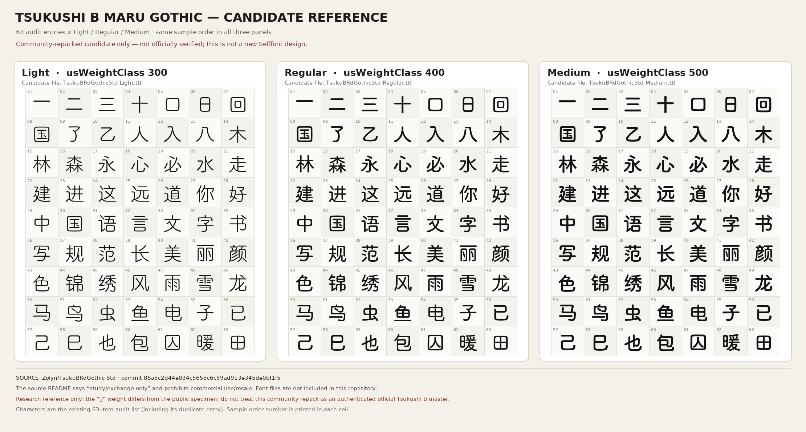

# 筑紫 B 社区候选参考图（2026-10-21）

## 这张图是什么

这是从社区仓库 `Zolyn/TsukuBRdGothic-Std` 的本机候选 TTF 渲染出的**研究参考样张**：现有 63 项审计样本 × Light / Regular / Medium，按相同顺序并排展示。它只说明这三个本地候选文件实际渲染出来的样子，**不是我们重设计后的字形，也不是官方筑紫 B 字样认证**。

样本包含审计表中的重复项（`国`出现两次），每格左上角是样本序号。三个候选文件的内部 `usWeightClass` 为 300/400/500。

## 来源与限制

- 仓库：[`Zolyn/TsukuBRdGothic-Std`](https://github.com/Zolyn/TsukuBRdGothic-Std)，固定提交 `88a5c2d44e034c5655c6c59ad913e345de0bf1f5`。
- README 说明字体提取自原作者分享的 Magisk 模块，改名后用于 PC 端；版权属于字体公司，字体仅供学习交流，禁止商用/倒卖。仓库未提供正式许可证文件。
- 因此这里只保留标明来源的学习交流样张，**不提交或打包 TTF**，不将候选说成官方版本，也不将本图用于商业用途。
- 公开筑紫 B 样张里的“包”与候选文件的视觉重量有明显差异；候选身份仍需核实。请勿把本图当作筑紫 B 官方字样的定版证明。

## 生成方式

使用本机 `/tmp/TsukuBRdGothicStd-{Light,Regular,Medium}.ttf` 及现有审计清单 `docs/round-preview/2026-10-19-maruko-track/11-centerline-length-baseline-63-items.csv` 逐字渲染；本机 TTF 没有加入 Git。该预览不修改生产字体、不接入 `build.py`，也不代表新设计实现。
