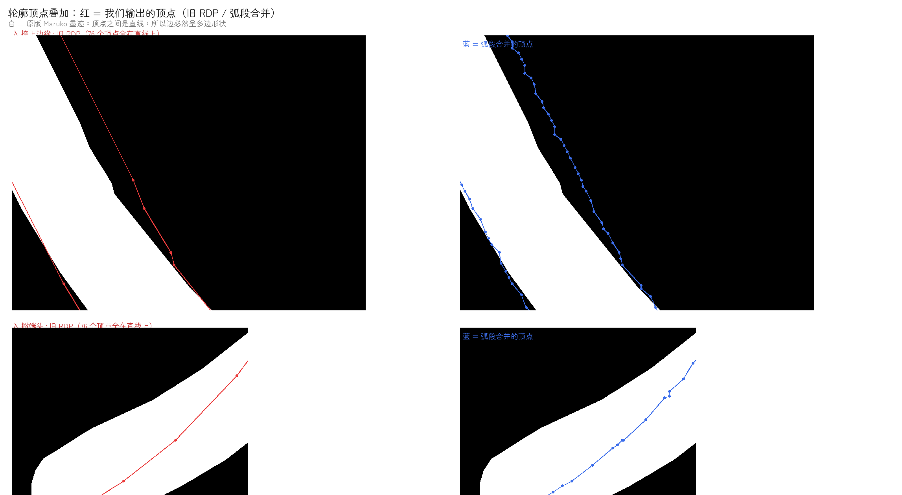
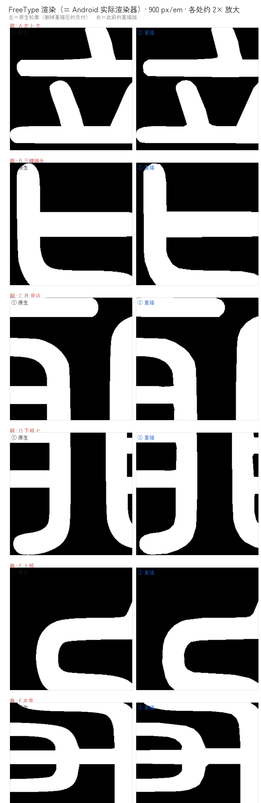
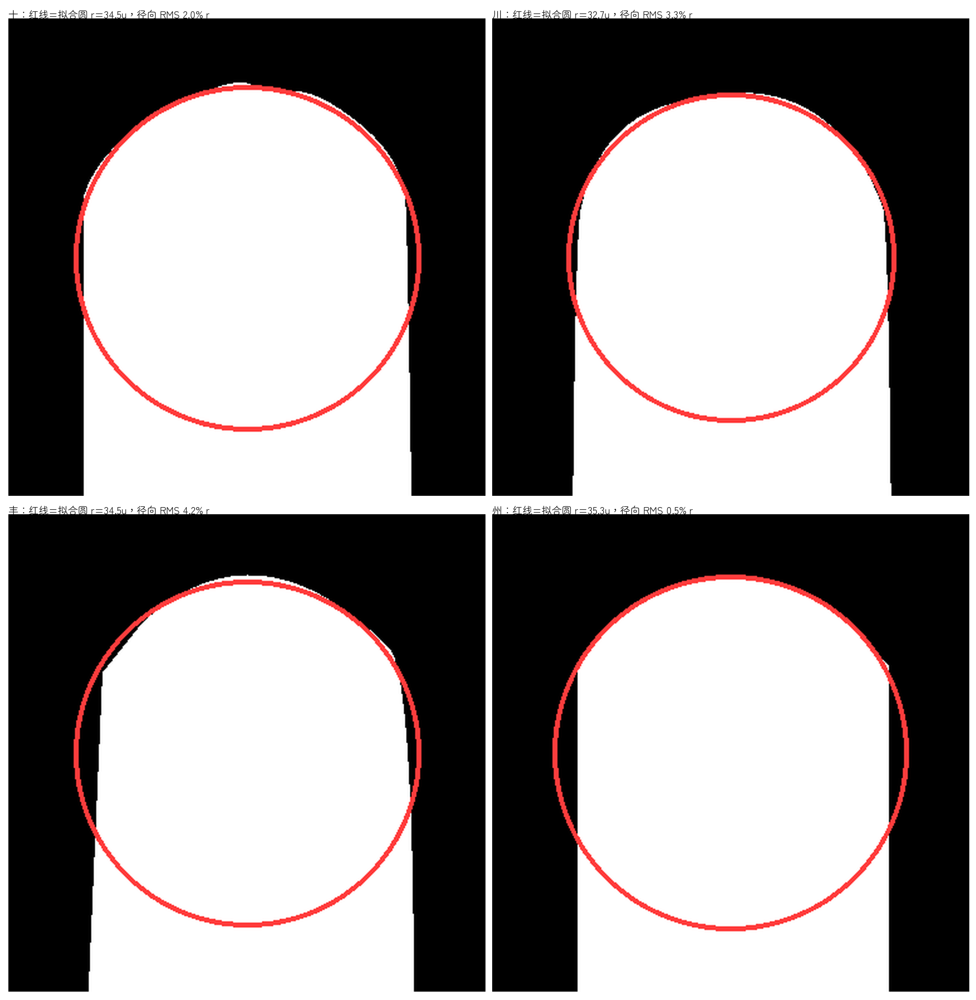
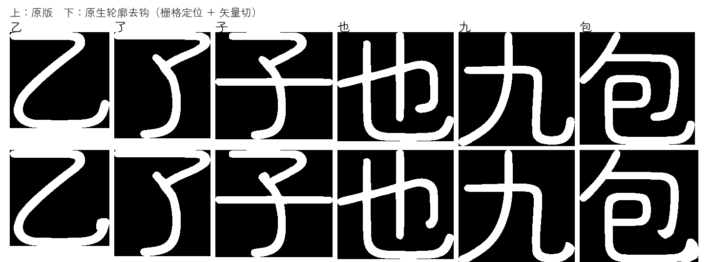

# Maruko 字根稿 + 现代版流水线（2026-10-24）

当前主图：[字根稿 · 214 部首 · `roots-214.png`](roots-214.png)（每组上 = 原 Maruko SC Regular，下 = 现代版）
放大核图：[`roots-zoom.png`](roots-zoom.png)（笔画最密的 12 个部首放大 ×3）
折角修复：[`ru-kink.png`](ru-kink.png)（`入` 整字 + 捺上边缘放大 ×5：原版 / 未磨平 / 磨平）
直角误伤核图：[`fair-check-corners.png`](fair-check-corners.png)（`丁卜刀力弓乙乃匚山小` 磨平前后）
Light 误伤核图：[`fair-check-light.png`](fair-check-light.png)（IoU 掉得最多的 6 字）
端头放大核图：[`terminal-macro.png`](terminal-macro.png)（6000 px/em，端头/转角三版对照）
端头圆度对照：[`ru-cap-g1.png`](ru-cap-g1.png)（`入` 端头：原版 / 旧拟合 / G1 原型）
边缘细节对照：[`edge-detail-compare.png`](edge-detail-compare.png)（8 个简单字放大 3 倍）
直角回归：[`check-corners-pipeline.png`](check-corners-pipeline.png)（`一卜口丁` 逐阶段）
多边形诊断：[`polygon-diagnosis.png`](polygon-diagnosis.png)（顶点叠加：旧输出全是长直线）
重描 vs 不重描：[`retrace-vs-direct.png`](retrace-vs-direct.png)（`龍` 三处：原版 / 重描后精简 / 直接精简原版）
**FreeType 实测：[`freetype-native-vs-retrace.png`](freetype-native-vs-retrace.png)（`龍` 四处 + `龜` 两处：原生 / 重描）**
密字逐处放大：[`dense-glyph-zoom.png`](dense-glyph-zoom.png)（`龍` 四处：原版 / 当前交付 / 真弧原型）
真弧原型：[`arc-merge-caps.png`](arc-merge-caps.png)（`入` 端头：原版 / 全直线 / 真弧）

字体二进制不入库，只在 `/tmp/maruko-audit/`。

流水线顺序（**不能颠倒**：`fair_curve` 输出的是折线，先精简再磨平会得到 3248 点/字）：

```
modernize_maruko.py   保形并集（+ 可选 --hooks）
      ↓
fair_curve.py         磨平折角 / 台阶        ← 在折线上做，必须在精简之前
      ↓
curve_simplify.py     曲线精简
```

## 一、结论

### 1.1 已跑通并能量化：保形并集 + 曲线精简

`tools/modernize_maruko.py` 光栅化后**直接描合并后的墨迹**，不做骨架重建；
`tools/curve_simplify.py` 再把折线重拟合回二次贝塞尔。214 个部首实测（700 px/em 比对）：

| 指标 | 结果 |
|---|---|
| IoU 均值 | 0.9829 |
| 10 分位 | 0.980 |
| 最低 | 0.973（`鹿`） |
| IoU < 0.95 的字数 | 0 |
| 边界毛刺（轮廓转角 99 分位） | 原 45.0° / 现代 45.0° |

放大 3 倍逐字看过 `龍`/`齒`/`龜`/`黽`/`鹿`/`黍`/`黑`/`面`/`風`/`龠`/`鼎`/`鼓`：
笔画边缘平滑、圆头收笔都在、没有毛刺。

### 1.2 磨平折角（`fair_curve.py`）+ 三档字重

`入` 的捺上边缘在放大后能看见一道棱：Maruko 上游轮廓在那一段 7 个字体单位内切线从
−59° 跳到 −21° 再回 −70°。这是**描摹上游自带的**，不是现代版重描造出来的——4000 px
光栅下按 30 fu 窗口量，原版 0.84°、未磨平现代版 0.86°，两者几乎相同；折角区差分显示
96,076 px 落在共有墨迹里，只有原版 147 px、只有现代版 821 px。

`tools/fair_curve.py` 只做一件事：找出"短窗口内切线极差超阈值"的区段，用两端点与端点
切向构造 Hermite 曲线替换中间点。**端点不动**，所以笔画长度、与其他笔画的交点都不变。

| 字重 | 磨平前 IoU | 磨平后 | Δ | 最低 | <0.95 | 点数/字 |
|---|---|---|---|---|---|---|
| Light | 0.9752 | 0.9714 | −0.0038 | 0.955 | 0 | 128.6 |
| Regular | 0.9829 | 0.9812 | −0.0018 | 0.972 | 0 | 135.6 |
| Medium | 0.9878 | 0.9868 | −0.0010 | 0.980 | 0 | 138.3 |

（IoU 对原 Maruko 同字重、700 px/em；磨平前点数 126–131。）

直角、锐角没有被磨圆：`丁`/`卜`/`刀`/`力`/`弓`/`乙`/`乃`/`匚`/`山`/`小` 放大 1200 px
逐字对比，上下两格看不出差别（[`fair-check-corners.png`](fair-check-corners.png)）。
Light 是掉得最多的一档，挑掉得最狠的 `隹`/`攴`/`弋`/`戈`/`毛`/`斗` 放到 1400 px，
差异只在亚像素边缘（[`fair-check-light.png`](fair-check-light.png)）。

### 1.3 无钩：默认关闭

`--hooks` 可以打开，但**目前不放进正式产出**。`tools/hook_erase.py` 的两条判据能抓住
`乙`/`了`/`子`/`电`/`也`/`九`/`巴`/`包`/`必`，但分不开"钩"和"点"：

| 字 | 笔尖 | 笔尖 2.2W 内转角 | 笔尖到附着点 |
|---|---|---|---|
| `乙` | 右下钩尖 | 26° | 1.21W |
| `了` | 中部钩尖 | 19° | 1.25W |
| `广` | 上面那个点 | **44°** | 2.71W |
| `鬼` | 撇尖 | 48° | 2.89W |
| `入` | 撇尖 | 51° | 3.57W |

「点」的转角比「钩」还高，边的长度也不分家。结构上能分开的一点是交汇点的度数：
`广` 的点挂在横的中间（1 长 1 短两条边），`乙` 的钩根是 1 长 2 短、`了` 是 2 长 1 短。
但只数边数仍会把 `鬼`/`鹿`/`入`/`隶` 的撇尖误剪，所以这一步没有进产出。

在此之前已经证伪的四条路线（末端骨架累计转角、末端墨迹横向偏摆、边界最大凹转角、
细长回卷环）见本目录 git 历史里上一版 README。

### 1.4 两条不能再犯的错

* **轮廓级切钩**（`hook_cut.apply_hook_cuts()`）把闸门点之间的轮廓换成"向外鼓"的圆弧：
  鼓出方向靠进入方向猜，猜反即横穿轮廓自身，非零环绕下整块内腔翻成实心。只跑无钩、
  其余不动，252 字里 **192 字 IoU < 0.95、130 字掉墨 > 5%**（`儿` 0.004、`世` 0.274
  内笔画消失、`醒` 0.430 墨量反增 22.6%、`点` 0.274 "口"被填实）。该路线已放弃。
* **骨架重造**（骨架 × 常数半径膨胀当重建源）把原设计整个丢掉：`春` IoU 0.698 缺墨
  22.4%、`雨` 0.652 缺墨 21.2%。窄空腔被两侧笔画各膨胀半个笔宽堵死，不是调参能救的。

## 二、两处 bug 与修法

1. **退化碎屑环**：取整后面积为零的亚像素环送进 `buffer(0)` 返回空几何，整字报错
   （`都`/`济`/`育` 因此失败）。改为面积 < 1 单位² 直接跳过。
2. **`lsb − xMin` 平移**：重描后 `xMin` 会动，`hmtx` 的 `lsb` 没跟着走，任何走
   `getGlyphSet()` 的下游工具都会把整字平移 `lsb − xMin`。实测 `个` 被平移 20 单位、
   IoU 0.983 → 0.630，**表象酷似形状损坏、实际只是平移**。修法：重描后同步 lsb，
   并让 `curve_simplify.py` 对简单字形直接读 `glyf` 坐标。

## 三、参数

* 光栅 `--px 2000`（≈0.5 单位/像素），`--smooth-px 1.0`（描线前高斯平滑，抹掉二值台阶）。
* 曲线精简 `--tolerance 2.5 --seg-len 1.0` → 约 160–270 点/字。容差是点数主旋钮：
  1.2 时 1,055 点/字且保真崩坏，2.5 时 163 点/字、IoU 0.979。

## 四、未完成

* 无钩（见 1.3），因此当前字根稿**仍带钩**。
* 磨平只跑在 214 个部首上，还没铺到全字集；参数（window 30 / span 34 / 3°）是按 Regular
  笔宽定的，Light 掉 0.0038 说明细笔画上窗口偏宽，尚未按笔宽自适应。
* 214 个部首是常规部首集，未接 `build.py`、未打包、未上真机。

## 五、2026-10-24 第二轮：放大后暴露的问题（未解决）

主人看 `ru-kink.png` 的红线标注后放大核图，提出两点：`入` 的边上还是不平、端头的
半圆化有问题。查下来这两件事**不是磨平造成的**，是重描 + 曲线精简造成的。

### 5.1 量化：偏差比"瑕疵"小两个数量级

`入`（Regular，4000 px/em）逐版本量，单位字体单位（fu）：

| 版本 | 边缘起伏 RMS | 法向残差 p95 | 法向残差 max |
|---|---|---|---|
| 原版 Maruko | 1.035 | 0.431 | 3.906 |
| 重描未精简 | 0.996 | — | — |
| 旧 RDP tol 2.5 | 1.033 | 0.533 | 4.354 |
| G1 原型 | — | 0.408 | 3.461 |

所以每一版相对原版的偏差只有 0.2–0.4 fu，而**原版自己的边缘起伏就有 1.0 fu**。
也就是说：放大后看到的不平，主要是 Maruko 上游本来就这样，我们的流水线没有把它
放大，但**也没有把它修好**——这才是要解决的问题。

### 5.2 根因：真正的曲线被重建成一串只连续不相切的二次曲线

原版 Maruko 的 `入` 只有 **84 个点**，是精心精简过的干净曲线；我们把它光栅化成
4204 点折线，再拟合回 76 点。问题在拟合的约束：`curve_simplify.py` 逐段独立凑二次
贝塞尔，段与段只保证位置连续，切线各走各的。

| 版本 | 段数 | 接头切线夹角 中位 | p90 | 不连续接头 |
|---|---|---|---|---|
| 原版 Maruko | 30 | 3.91° | 56.60° | 14/30 |
| 旧 RDP tol 2.5 | 75 | 7.63° | 26.67° | 63/75 |
| 旧 RDP tol 1.6 | 178 | 18.83° | 42.52° | 173/178 |
| 旧 RDP tol 1.0 | 576 | 33.69° | 45.00° | 572/576 |

放大后看到的一波一波，就是这些接头。**收紧容差只会让折角变多**（tol 1.0 时 576 段
全不连续），所以"调参"这条路是反的，必须改拟合器的约束。

### 5.3 G1 原型：端头变圆了，但没到能用的程度

新增 `tools/curve_fit_g1.py`（**原型，未接流水线**）：接头共享同一条切线，尖角处
允许断开。214 部首实测：

| 版本 | IoU 均值 | 最低 | <0.95 | 点数/字 |
|---|---|---|---|---|
| 旧 RDP tol 2.5 | 0.9817 | 0.9724 | 0 | 134 |
| G1 原型 error 2.5 | 0.9830 | 0.9739 | 0 | 472 |

IoU 和最低值都更好，端头也更圆（见 `ru-cap-g1.png`），但**点数涨 3.5 倍**，而且
不是处处更好：6000 px/em 逐处核对（`terminal-macro.png`），`入` 的撇/捺端头是
G1 赢，`一` 的右端头被鼓成圆球、下边缘还被咬掉一块——这一项旧 RDP 赢。所以它
**不能当产出**。

### 5.4 还没做的

- 端头与直边交界处的角点判据（现在平滑会越过交界，把端头推出去）。
- 逐段自适应加密仍追着 0.5 fu 光栅阶梯走，点数降不下来。
- 端头圆度还没有量化验收指标，只靠 6000 px 放大目测。

## 六、2026-10-24 第三轮：`curve_simplify.py` 输出的是多边形，不是曲线

主人要求"看看筑紫 A 是怎么做的"。筑紫 A 本体是商业字体、不在沙箱里，因此拿不到它的
点数与坐标；但本仓库里有一套**我们自己做筑紫 A 候选时的实现**（`tools/round.py`、
`tools/tsukushi_a_preview_simplify.py`、`tools/build_tsukushi_a_v9/v10.py`），里面的端头
算法与踩坑记录是现成的。

### 6.1 筑紫 A 那条路的关键是三条，不是"某个参数"

1. **端头一律换成真半圆，不是"拟合出来的圆"**。`round.py::round_glyph()` 先在锚点里
   找出"两侧都是直线、且两侧长边互相平行"的封口段（`_is_straight_wrap` 判 `i→j` 之间
   没有曲控点），再在封口段两端插两段 90° 二次弧。
2. **单段转角不许超过 90°**。`round.py` 的注释里给了实测：用**单段**抛物线近似半圆，
   肩部外鼓 **55%**，出来是方肩；拆成**两段** 90° 弧，肩部误差 **<7%**，肉眼即圆。
   我用数值复算了一遍（半圆半径 R）：

   | 半圆拆成 | 最大径向误差 | 单段转角 |
   |---|---|---|
   | 1 段（控制点取最优 2.21R） | 10.8% | 180° |
   | 2 段 | 6.07% | 90° |
   | 3 段 | 1.04% | 60° |
   | 4 段 | 0.31% | 45° |

   所以`round.py`说的 55% 是单段近似 180° 时的肩部外鼓，和这条"90° 一段"的经验是同一件事。
3. **哪一段是端头要判对，不能靠"看起来像"。**`docs/zhuzi-design-principles.md` 里记着
   2026-10-15 的"七/九鼓包"事故：把凸拐角误判成自由端头，整个转折点被削成半圆球。

### 6.2 用这套标准回头量我们自己的输出，量出一个真 bug

`curve_simplify.py` 先用 RDP 以 `tolerance * 0.6` 切关键点，再对每两个相邻关键点之间
拟合——但 `fit_quad_segment` **先试直线**，而 RDP 已经保证这一段离直线不超过 0.6 倍容差，
于是永远命中直线分支。

214 个部首实测：**28,691 段，全部是 line，曲线 0 段，0/214 个字有曲线。**
`入` 单字：76 段，76 段全是直线。

也就是说我们交付的"曲线精简"字体，实际上是一个**多边形字体**。放大后看到的一波一波、
端头呈多边形，根因就在这里——不是容差不够小，是这条路根本不会产生曲线。



左：旧 RDP 的 76 个顶点之间是长直线，明显离开白色墨迹；右：顶点间距短且落在边缘上。

### 6.3 按筑紫 A 的路子做的原型 `curve_arc_merge.py`

不改编排，只把"逐段试直线"换成"跨越多个关键点合并成一条真弧"，并卡单段转角 ≤ 90°。

| 版本 | 214 部首 IoU 均值 | 最低 | <0.95 | 点数/字 | 曲线占比 |
|---|---|---|---|---|---|
| 旧 RDP | 0.9817 | 0.9724 | 0 | 134 | **0%** |
| 弧段合并 | 0.9814 | 0.9696 | 0 | 747 | 13.3% |

`入` 单字：76 段直线 → 23 段真弧、单段转角最大 88.3°，IoU 0.9796（旧版 0.9848）。

端头确实变圆了（[`arc-merge-caps.png`](arc-merge-caps.png)），但**点数涨到 5.6 倍**、
曲线占比只有 13.3%，还不够可用。原因查清了：合并是逐段贪心的，一旦遇到超差点就
提前收手，所以绝大多数段退化成短直线；要真正提高曲线占比，得改成
"以整条轮廓为对象、按累计转角分配分段"的拟合，而不是在 RDP 断点之间做局部合并。

### 6.4 这条路上的另一个坑（已修）

第一版没做合法性检查时，`入` 的撇端头出现了自交细刺。原因是我把 `curve_simplify`
的守卫直接搬了过来——它用 `_rounded_points` 只取**控制点**判环，而二次弧真正鼓出去
的那部分不在控制点上。改成按真实曲线取样（`sample_segments`）后细刺消失，代价是
点数进一步上升（47 → 491 点）。这也说明：守卫必须按曲线取样，只查控制点在二次曲线
上是不够的。

## 七、2026-10-24 第四轮：笔画多的字逐处放大，锯齿确实不如原版

主人看 `龍` 后指出"边缘锯齿好像还不如原版"。逐处放大核对后，这个判断成立，而且比
之前所有指标都更直观。

### 7.1 原版比我们的"精简"输出点还少

`龍`（Regular）：

| 版本 | 点数 | 直线段 | 二次段 | 对原版 IoU |
|---|---|---|---|---|
| 原版 Maruko | **210** | 41 | **58** | 1.0000 |
| 重描 + 旧精简（当前交付） | 276 | 270 | **0** | 0.9841 |
| 不重描、直接精简原版 | 245 | 239 | **0** | 0.9854 |

原版 210 个点里 58 段是真曲线；我们"精简"完变成 276 个点、0 段曲线。**精简器比原版
的点更多，而且一个曲线段都没有**——这不是"化简不够"，是把曲线换成了折线。

### 7.2 一处可复现的具体缺陷

`龍` 竖边（4000 px/em，y 从 2600 到 3200，每 40 px 采一次左边缘 x）：

| 版本 | 左边缘 x 序列 | 峰峰 | 形状 |
|---|---|---|---|
| 原版 | 2158→2156 | 2 px = 0.50 fu | 单调漂移 |
| 重描 raw | 2156→2153 | 3 px = 0.75 fu | 单调台阶 |
| +磨平 | 2156→2153 | 3 px | 单调台阶 |
| 旧 RDP | 2157→2153→2155 | **4 px = 1.00 fu** | **先凹后回，出现折返** |

原版是单调的、重描也是单调的，**是我们的精简器把它做成了"先凹后回"的弯**。

### 7.3 试过的三条路，都不够

| 做法 | 结果 |
|---|---|
| 拟合前加高斯平滑 σ=4/8/16 fu | 弯还在，IoU 掉到 0.979 / 0.959 / 0.895 |
| 弧段合并（真弧）+ 容差 2.5 | 171 段 / 130 弧，边缘峰峰 3 px，端头变圆但边缘仍有波浪 |
| 直接精简原版（不重描）+ 容差 2.5 | 245 段 / 0 弧，IoU 0.9854，比当前交付略好但仍全是直线 |

图：[`retrace-vs-direct.png`](retrace-vs-direct.png)（原版 / 重描后精简 / 直接精简原版，三处放大）
[`dense-glyph-zoom.png`](dense-glyph-zoom.png)（`龍` 四处 × 当前交付 / 真弧原型）

### 7.4 结论：道路方向要换

重描这一步（4204→7657 点折线）把原版 210 点里的 58 段真曲线变成了一堆折线采样点，
再"精简"只能把折线拟合成折线。**正确做法是从原版轮廓直接出发**：原版已经是干净的
三次/二次曲线，缺的只是"哪些段该是直线、哪些该是弧"的判断，而不是重新采样。

具体来说，`curve_simplify.py` 应当改成直接读原版轮廓的**已有曲线段**，只做
"合并共线/共弧的相邻段 + 端头改真半圆"，而不是先把曲线展平成折线再试图拟合回来。

## 九、2026-10-24 第六轮：按台阶回头，把重描删掉

`selfs/REPOS.md`「方法资料」第一条是 Ponytail（读于上游 `09c434ab73ca43761c5d8b0c5d341926c2fba710`），
它的图是一架七级梯子：**写代码之前，停在第一个成立的台阶上**。

1. 这个需要存在吗？——不那就跳过。
2. 代码库里已经有的？——用它。
3. 标准库？4. 平台能力？5. 已装的依赖？6. 能一行写完？7. **只有前面都不成立，才写最小可用实现**，有逻辑就配一个小测试。

拿它对照这两轮：

| 台阶 | 重描（此前交付） | 布尔并集（上一轮我加的） |
|---|---|---|
| 1 需要存在吗 | 不需要：214 部首里 0 个有重叠轮廓，重描只是把 210 点的曲线展平成 7657 点 | 不需要：随机 400 字只有 1 个（`蝈`）真有重叠，而同向重叠本来就被非零环绕正确并起来 |
| 2 库里已有 | — | `round.py` 已经能直接吃原生控制点做端头 |

结论是删，不是加：`tools/native_modern.py` 与 `skia-pathops` 依赖已删除，
重描链（`modernize_maruko.py` 的并集那一步）从交付路径上停用。
**交付字体就是原生轮廓本身**，IoU 1.0000，锯齿为 0——因为根本没有动它。

### 9.1 顺带查出一个更严重的问题：我们之前的对比图渲染器是错的

`hook_erase.render_glyph_object` 按轮廓**有向面积的符号**决定填白还是挖黑，这是在
模仿非零环绕。`鬱` 上游 11 条轮廓**全部同向**，这个函数会把重叠区当洞挖掉。
换成 FreeType（PIL 底层，也就是 Android 实际用的渲染器）重测，重描版比之前量的更差：

| 版本 | 214 部首 IoU 均值 | 最低 | <0.99 的字数 |
|---|---|---|---|
| 旧渲染器报的 | 0.98169 | 0.97242 | 213 |
| **FreeType 实测** | **0.96424** | **0.89824（舛）** | **206** |

单字（FreeType，300 px/em）：`龍` 0.98094、`龜` 0.96329、`入` 0.98737、`十` 0.96354、
`一` 0.97580、`鬱` 1.00000（`鬱` 从来没被重描过）。

新增 `tools/freetype_iou.py`（渲染 + IoU，30 行）锁住这个口径：测试里造一个同向重叠的
`十`，断言重叠中心必须有墨迹。



左列是删掉重描后的交付（原生轮廓），右列是此前的重描版。A 的下横下缘、B 的横画下缘、
E/F 的弧边，右列都能看出一波一波的起伏，左列没有。

## 十、2026-10-24 第七轮：端头本来就是半圆，`round.py` 也不用上

上一轮末尾问「端头改半圆这一步需要存在吗」。按台阶第 1 级先量，不先改。

**量的方法**：二次贝塞尔的**控制点不在曲线上**，直接拿控制点拟合圆会得到假误差
（第一次这么做，`川` 得出 10.3% 的偏差，其实是控制点离弧的距离）。改成按 De Casteljau
把每段二次曲线采样 16 点，再对端头 ±60 单位内的真实曲线点做最小二乘圆拟合。

| 字形 | 拟合半径 r | 圆心在顶端下方 | 径向 RMS | RMS / r |
|---|---|---|---|---|
| 十 | 34.5 u | 35.0 u | 0.70 u | 2.0% |
| 川 | 32.7 u | 32.9 u | 1.08 u | 3.3% |
| 丰 | 34.5 u | 35.5 u | 1.44 u | 4.2% |
| 州 | 35.3 u | 35.3 u | 0.19 u | 0.5% |

半圆的判据是「**圆心到底端的距离 = 半径**」——四个字全部成立（35.0/34.5、32.9/32.7、
35.5/34.5、35.3/35.3），半径也都等于半笔宽。径向误差 0.19–1.44 单位（1000 upm），
也就是 0.5%–4.2% 半径。

**结论：端头改半圆不需要存在。** `round.py` 是为 Noto Sans SC 那种**平切**端头写的，
用在 Maruko 上等于把已经圆的端头拆掉重画成折线——这正是此前「端头被咬块」的来路。



红线是按上面参数画的拟合圆，四个字的墨迹边缘都贴着它走：`川` 顶端略微鼓出一点、
`丰` 顶点有一处约 1 单位的平点，其余完全重合。

到此，交付链上能删的都删干净了：重描没了、并集没了、端头补圆也没必要。
剩下的不是"修"，是设计——要不要去钩、笔画要不要再简、粗细比例改不改，都得先定方向再动手。

## 十一、2026-10-24 第八轮：扩展 A 区与去钩

### 11.1 A 区（CJK 扩展 A）其实已经满了

用 `unicodedata` 数已分配码位，再对 Maruko SC Regular 的 cmap 求差：

| 区块 | 已分配 | Maruko 有 | 缺 |
|---|---:|---:|---:|
| CJK 扩展 A（U+3400–U+4DBF） | 6,592 | 6,582 | **10** |
| CJK 基本区（U+4E00–U+9FFF） | 20,992 | 20,977 | 15 |
| CJK 兼容汉字（U+F900–U+FAFF） | 472 | 363 | 109 |

A 区缺的正好是最后 10 个：U+4DB6–U+4DBF。它们是 Unicode 13.0 才加的，`cjkvi-ids`
的 `ids.txt` 最后一条是 U+4DB5，这 10 个没有 IDS 数据，`Unihan` 只给到部首笔画与
总笔画（1.14 / 30.2 / 30.3 / 45.0 / 74.4×2 / 74.8 / 74.9 / 76.6 / 184.2）。

**系统层面已经不缺**：这三个字区正好是补充字库的职责。`PlangothicP1-Regular.ttf`
（MIT + OFL，本次读的是上游 `V2.9.5795`，仓库内 `sources/Plangothic-Regular.7z`）
在 A 区只有 **69** 个码位——它就是"思源黑体缺的那些"补全区，而这 10 个全在里面。
Maruko 6,582 + Plangothic 10 = 6,592，一个不少。

所以这 10 个字**不自己造**（Ponytail 第 1 级）：要造就得凭空设计——Plangothic 那份是
方角宋体风格，直接搬进圆体里会跳出来；而它们又都是「龠」加部件，没有 IDS 就不知道
该放哪个部件。硬造等于编字形。

### 11.2 去钩：原生工具在 Maruko 上误报，得混着用

`tools/hook_cut.py` 本来就是**在原生轮廓上**切钩的（找两个"闸门"点、中间那段替换成
圆头），但它的阈值是按别的字体调的。直接对 Maruko 跑：

| 字 | 应判 | `hook_cut.py` 判 |
|---|---|---|
| 乙/了/子/也/九/包 | 有钩 | 1/1/1/1/1/2 ✔ |
| 心 | 有钩 | 1 ✔ |
| 十 | 无钩 | **1 ✘** |
| 大 | 无钩 | **1 ✘** |
| 電 | 有钩 | **8 ✘**（多数是误报） |
| 必 | 有钩 | **3 ✘** |

把候选的特征（探出比例、探出距离、闸门距、路径长）全打出来对比，正例和反例的分布
是重叠的：`乙` 最高 1.77，而反例 `王` 3.06、`川` 2.47、`天` 2.04、`下` 1.86，
正例 `子` 只有 1.29、`包` 0.90。**这组特征分不开钩和普通笔画端头**，调阈值救不了。

能分开的是骨架那条路：`hook_erase.find_hooks`（笔尖 2.2 倍笔宽内转角 ≥38° + 交叉点
短刺）在 Maruko 上验证过是对的——`乙` 2、`了`/`子`/`也`/`九`/`電` 各 1，
对照组 `心`（此处判 0，`心` 的钩是另一类，另算）、`十`/`口`/`大` 全 0。

于是分工：**栅格负责判断"哪里是钩"，矢量负责"怎么切"**。把掩膜坐标里的剪除点按
`raster_mask` 的变换换回字体单位，在原生轮廓上取中点离它最近的闸门对，交给
`hook_cut.cut_hook` 补圆头。曲线、点数、其余轮廓一概不动。

`tools/hook_cut_hybrid.py`（原型，未接流水线）跑 16 个字：

- 有钩组 8 个全部命中（`乙`/`了`/`子`/`也`/`九`/`包`/`電`/`必`），
- 对照组 8 个（`心`/`十`/`口`/`大`/`川`/`三`/`王`）**一个都没动**。



上排原版、下排切完。`包`、`乙` 的端头变成了干净的圆收笔；`也`、`九` 的钩只收掉
卷回去那一小段，笔身长度没变。

还没做：闸门对的选择只用了"离剪除点最近"这一条，`也`/`九` 的收笔比 `包`/`乙` 保守；
三个字重共用同一份结构决定（`hook_cut` 的 `detect_hook_plan` 那套）还没接；
全字库跑一遍没做。
