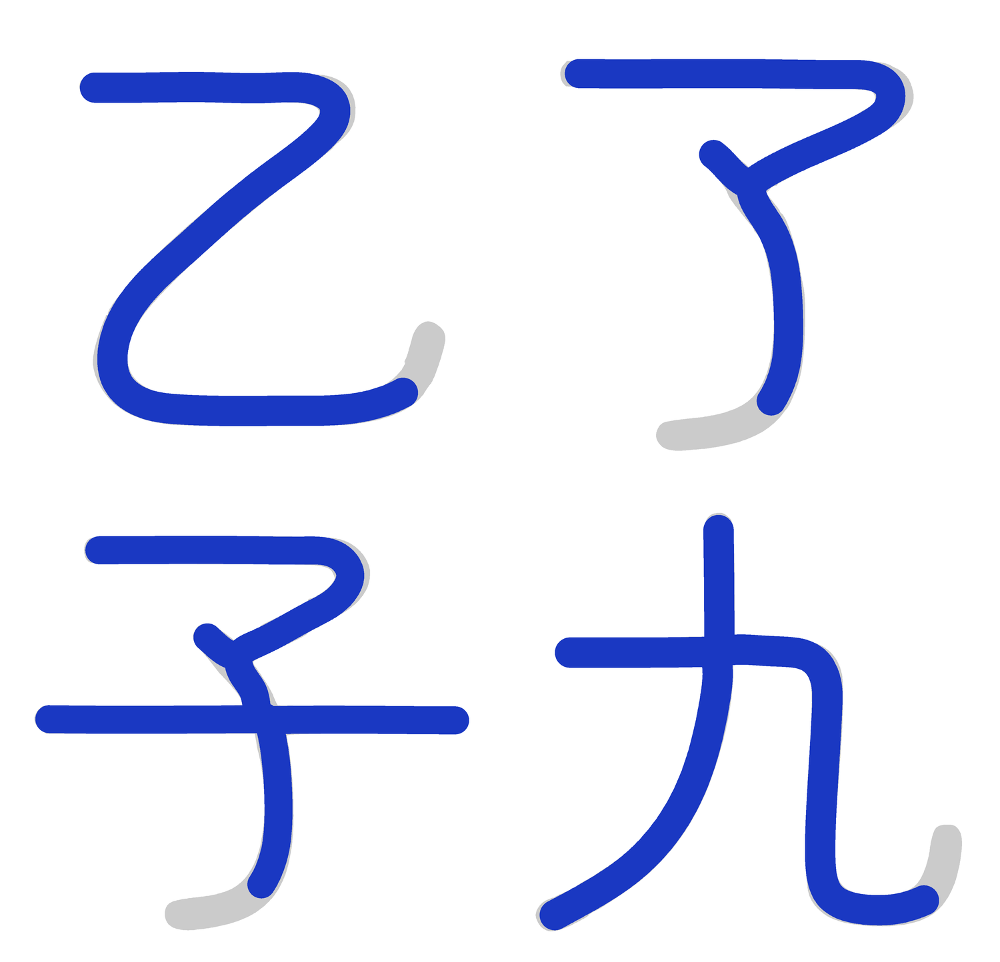

# 2026-10-26 覆盖补齐与二创四字

## 一、覆盖去哪了（实测）

主字体是文渊圆体 `WenYuanRoundedSCVF.ttf` v1.100（48,779,368 B），不是 Maruko。

| 对象 | 码位总数 | 主人贴的那批 |
|---|---|---|
| 文渊主字体 | 33,032 | **0 / 315** |
| 构建 `prune_blank_mappings` 后 | 33,032 → 33,032 | 剪掉 **0** |

文渊基底停在 Unicode 14 之前：连 U+11F00（Kawi）、U+1E030（西里尔修饰）都没有。
主人贴的 315 个码位里 20 个到 Unicode 18.0 仍未分配（见第二节之二），其余 295 个是已分配码位。

## 二、按上游做法补（不自己画）

上游 MakeFontsGreatAgain 的做法是投放分版本补充字件、由 fonts.xml 补字区兜底。
照此接进 `build.py` 的 `SUPPLEMENTAL_FONT_SOURCES`：

| 字件 | 来源 | 覆盖 |
|---|---|---|
| `Unicode18-new.ttf` | MFGA git blob `4314ad3`，OFL | 162 |
| `Unicode17-new.ttf` | MFGA git blob `e877906`，OFL | 29 |
| `NotoSansPro.otf` | MFGA git blob `a37c8e3`，OFL | 47 |
| `UnicodiaFunky.ttf` | Mercury13/unicodia，OFL | 69 |
| `NotoEmoji.ttf` | google/fonts，OFL | 85 |
| `Noto-COLRv1.ttf` | googlefonts/noto-emoji，OFL | 104 |

并集 **298 / 315**。

## 二之二、20 个未分配码位：不自绘

Unicode 18.0 仍未分配的有 20 个码位（`tools/symbol_targets.py` 的 `UNASSIGNED`）：

```
U+1095A..1095C  U+10EEF  U+1CED5..1CEDC
U+1FAC7/C9/CA/CB  U+1FADE  U+1FAEC/ED/EE
```

它们没有标准字形，任何字库都没有。上一轮我按「区块邻居的风格」给它们各画了一个占位
（`tools/reserved_glyphs.py`），并在文档里报成 315 / 315。

**这一版整套撤掉**：主人 2026-10-27 判「如果你做得不够好就不要做」。自绘的形状没有任何
依据，放进字库只是把「缺字」变成「画错的字」，还让覆盖账失真 —— 宁缺毋滥。

`tools/reserved_glyphs.py` 已删除，它不在 `build.py` 的流水线里，删掉不改产物形态。
`tools/coverage_audit.py` 会因此报 17 个 missing，**这是预期结果**，判据不为了好看去改。

覆盖账如实写：**298 / 315，缺 17**（20 个未分配里 3 个恰好被上游补充字件画到）。

## 三、二创四字（母版是 Maruko，坐标是从骨架里量出来的）

前几轮我在文渊上做二创，被主人否了：**二创的母版是 Maruko**，文渊只是最终生产
路径里的宿主（文渊笔宽 82，Maruko 66/67，两者不是一套比例）。

`tools/maruko_skeleton.py` 直接从 Maruko 字形里量：

1. 栅格化（SS=2）→ 距离变换 → 中轴骨架 → 8 邻接图；
2. 「剥面条」反复取最长路径，一条一条把笔画取出来；
3. 末端**回卷钩**按累计转角 65° 切掉（`乙`/`九` 的钩短而急、`了`/`子` 的尾长而缓，
   只有累计转角对两者都成立）；
4. 中线用**平滑 B 样条**拟合（总残差 ≤ n·1²，平均每点 ≤1 单位），内部节点补到 3 重，
   每段 4 个控制点直接就是三次贝塞尔控制点 —— 中线因此 G1 连续；
5. 半宽**逐字实测**（量笔画中段横截面）：32.25 / 31.05 / 29.84 / 32.38；
6. 轮廓 = 每条中线按 2×该字半宽描边、**圆端头 + 圆转角**后并集。

第 4 步是本轮的关键改动。上一版中线是 RDP 折线（每 30 单位一个点），描边出来的圆角
是**折线拼接**，放大能看见一圈圈波纹；半宽还统一套 33，比实测粗 1–3 单位。
现在轮廓是「中线与半径 hw 的圆的闵可夫斯基和」：端头构造上就是半圆、拐角构造上就是
圆弧，整条轮廓没有折角，也没有需要事后修的接缝。

| 字 | 半宽 hw | IoU（对 Maruko，含被切掉的钩） |
|---|---|---|
| 乙 | 32.25 | 0.885 |
| 了 | 31.05 | 0.801 |
| 子 | 29.84 | 0.864 |
| 九 | 32.38 | 0.897 |

IoU 不再是满分是因为**钩被切掉了**：那部分面积本来就不该留在二创字形里，用整字 IoU
去奖励「把钩补回来」是错的量法（上一轮那版 IoU 0.849/0.795/0.836/0.874 里，有一部分
就是靠补墨迹极值把断口续长换来的）。



上排灰 = Maruko 原版（四字都带钩），蓝 = 二创（钩切掉，收笔是半径 hw 的正半圆）。


12 倍放大：端头是完整的圆弧，与笔身两侧相切，接缝处没有豁口、没有小角度。

## 四、仍未做

- 二创只覆盖 4 字（乙了子九），`也/包/必/電` 等仍未重画。
- 四字目前只落在 `tools/design_symbols.py`（设计样本），还没接进 `build.py` 的生产路径。
- 20 个未分配码位保持空白，等 Unicode 分配后再补。
