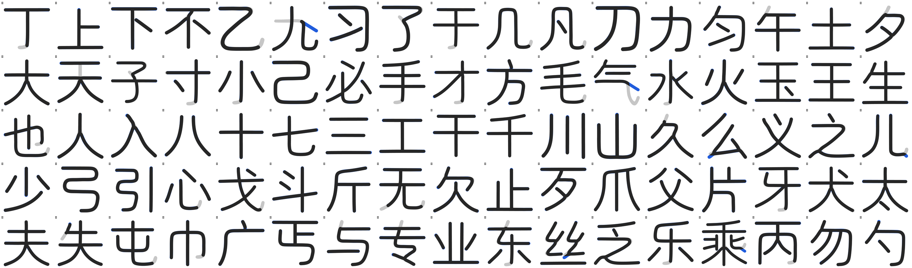
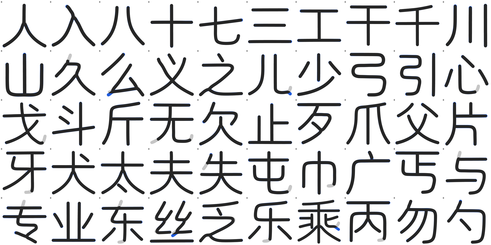
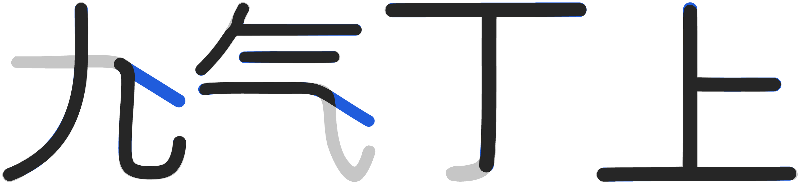

# 2026-10-26 覆盖补齐与二创字

## 一、覆盖去哪了（实测）

主字体是文渊圆体 `WenYuanRoundedSCVF.ttf` v1.100（48,779,368 B），不是 Maruko。

| 对象 | 码位总数 | 主人贴的那批 |
|---|---|---|
| 文渊主字体 | 33,032 | **0 / 315** |
| 构建 `prune_blank_mappings` 后 | 33,032 → 33,032 | 剪掉 **0** |

文渊基底停在 Unicode 14 之前：连 U+11F00（Kawi）、U+1E030（西里尔修饰）都没有。
主人贴的 315 个码位里 20 个到 Unicode 18.0 仍未分配（见第二节之二），其余 295 个是已分配码位。

## 二、按上游做法补（不自己画）

上游 MakeFontsGreatAgain 的做法是投放分版本补充字件、由 fonts.xml 补字区兜底。
照此接进 `build.py` 的 `SUPPLEMENTAL_FONT_SOURCES`：

| 字件 | 来源 | 覆盖 |
|---|---|---|
| `Unicode18-new.ttf` | MFGA git blob `4314ad3`，OFL | 162 |
| `Unicode17-new.ttf` | MFGA git blob `e877906`，OFL | 29 |
| `NotoSansPro.otf` | MFGA git blob `a37c8e3`，OFL | 47 |
| `UnicodiaFunky.ttf` | Mercury13/unicodia，OFL | 69 |
| `NotoEmoji.ttf` | google/fonts，OFL | 85 |
| `Noto-COLRv1.ttf` | googlefonts/noto-emoji，OFL | 104 |

并集 **298 / 315**。

## 二之二、20 个未分配码位：不自绘

Unicode 18.0 仍未分配的有 20 个码位（`tools/symbol_targets.py` 的 `UNASSIGNED`）：

```
U+1095A..1095C  U+10EEF  U+1CED5..1CEDC
U+1FAC7/C9/CA/CB  U+1FADE  U+1FAEC/ED/EE
```

它们没有标准字形，任何字库都没有。上一轮我按「区块邻居的风格」给它们各画了一个占位
（`tools/reserved_glyphs.py`），并在文档里报成 315 / 315。

**这一版整套撤掉**：主人 2026-10-27 判「如果你做得不够好就不要做」。自绘的形状没有任何
依据，放进字库只是把「缺字」变成「画错的字」，还让覆盖账失真 —— 宁缺毋滥。

`tools/reserved_glyphs.py` 已删除，它不在 `build.py` 的流水线里，删掉不改产物形态。
`tools/coverage_audit.py` 会因此报 17 个 missing，**这是预期结果**，判据不为了好看去改。

覆盖账如实写：**298 / 315，缺 17**（20 个未分配里 3 个恰好被上游补充字件画到）。

## 三、二创字（母版是 Maruko，坐标从骨架里量出来）

前几轮我在文渊上做二创，被主人否了：**二创的母版是 Maruko**，文渊只是最终生产
路径里的宿主（文渊笔宽 82，Maruko 66/67，两者不是一套比例）。

`tools/maruko_skeleton.py` 直接从 Maruko 字形里量：

1. 栅格化（SS=2）→ 距离变换 → 中轴骨架 → 8 邻接图；
2. **按交叉点一次分解**：度数 ≥ 3 的像素先摘掉，剩下的连通分量天然就是一条条臂；
   同一交叉点上方向几乎相反（>145°）的两条臂属于同一条**穿过去**的笔画，接回去；
3. 交叉点圆心补一个半径 = 半宽的**圆盘**；
4. 末端回卷钩按累计转角 65° 切掉；
5. 中线用**平滑 B 样条**拟合（总残差 ≤ n·1²，平均每点 ≤1 单位），内部节点补到 3 重，
   每段 4 个控制点直接就是三次贝塞尔控制点 —— 中线因此 G1 连续；
6. 半宽**逐字实测**（量笔画中段横截面）；
7. 轮廓 = 每条中线按 2×该字半宽描边、**圆端头 + 圆转角**后并集。

### 横折弯钩 / 横折提 → 横 + 捺（2026-10-27）

主人原话：「**九 气 横折弯勾/横折提 改横捺**」「不要自己加个折」。所以：

- 横从自由端走到**折点**就收笔；
- 折、弯、竖、钩整段**丢掉**；
- 折点处另起一段**独立**的捺：等宽、圆头、−32° 直走，长度到母版墨迹框为止。

判据在 `_fold_cut()`，全部量在骨架上：横 ≥5×半笔宽、横的纵向起伏 ≤0.6×半笔宽、
折点之后下沉 ≥8×半笔宽、尾巴末端**外卷**（收笔方向与折后方向差 ≥90°）、
折点在横的**右端**。这五条一起，`己`（横折后接着下一笔，不外卷）、
`了`/`子`（横撇只沉 7.3hw）、`方`（横末接撇不是折弯钩）都不会被误转。

即使判据成立，也**仍然逐字过目再收进白名单**（`NA_FOLD = {九, 气}`）：
`几`/`凡` 的竖段是笔画主体，切掉右半边就没了；`乙` 的「弯」也是笔画主体，
换成横捺会变成「七」。这两个字保持原结构，只去钩。

| 字 | 折点 | 丢掉的折+弯+竖+钩 | 接上的捺 |
|---|---|---|---|
| 九 | (845, −19) | 4.4 半笔宽（往下沉到 −163 的钩） | −32°，到墨迹框 |
| 气 | (684, 385) | 10.4 半笔宽 | −32°，到墨迹框 |

### 为什么不再「反复取最长路径」

上一版是「剥面条」：每次取一条最长路径，取一条删一条。它在交叉处会**串笔**——
交叉那一小片像素被多条笔画共用，取走一条就把别人的笔画删断。实测：

| 字 | 旧办法的结果 |
|---|---|
| 天 | 顶横与撇被串成一条 1264 单位的绕行，二创因此没有顶横、撇从左上角挑起 |
| 丁 | 竖与左斜串成 V 形，T 字路口描边后凹下去 |
| 上 | 横+竖+左横串成一根 |
| 九 | 捺被并进竖钩，量到的「捺」其实是母版的钩尾 |

`_assemble()` 改成一次分解 + 直穿配对之后，这四个字的笔画各自对上了。

### `天` 的顶横要独立

Maruko 的「天」把撇的起笔从顶横中点垂下来接住顶横（母版设计如此，像素实测两横之间
有一段 60 单位宽的竖）。主人要求顶横独立、平，所以在 `DETACH` 表里显式切断，
撇从中横上沿起笔（穿过中横，是「天」的本形）。

## 四、这一批覆盖到的字（85 个）

上一批 34 字，本轮**恢复 `也`**（它的末笔「乚」横段占六成，是笔画本体，按横折弯钩去切
会把笔画砍成一根斜线；现在只去钩、不转捺，图形成立），并**新增 50 字**：

```
人 入 八 十 七 三 工 干 千 川 山 久 么 义 之 儿 少 弓 引 心
戈 斗 斤 无 欠 止 歹 爪 父 片 牙 犬 太 夫 失 屯 巾 广 丐 与
专 业 东 丝 乏 乐 乘 丙 勿 勺
```

新增 50 字的 IoU 中位 0.943，最低 0.87（`丐`/`了` 这一档），墨量比 0.90–1.04 ——
**没有一个字低于 0.85**。

被数据否掉、没有收进来的：`又 及 尸 户 用 尺 丑 且 世 丘 氏 文 支 巴 电 中 女 面 己(收)
刃 兀 卅 …`（IoU 0.33–0.72：围框断笔、多部件串联、母版缺笔）。

数据在 `tools/design_symbols.py` 的 `MEASURED_STROKES`（结构：`{"hw": 半宽,
"strokes": [{"closed": 是否围框, "segs": [三次贝塞尔段...]}]}`；交叉点的圆盘用
零长度段表示，描边后就是一个半径 = 半宽的圆），按码位取字形用 `design_symbols.glyph(codepoint)`。





灰 = Maruko 原版，蓝 = 二创比母版多出来的墨，黑 = 重合。钩全部去掉，`九`/`气` 的
横折弯钩换成横 + 捺。



4 倍放大：`九`/`气` 的横收笔后接的是独立的一段捺（不再有折、竖、钩）；`丁`/`上` 的
T 字路口是圆盘补出来的圆弧过渡，不是凹口；所有端头都是半径 = 半宽的圆头。

### 自检数字（同窗口栅格比对）

85 字**墨量比**（二创 ÷ Maruko）0.86–1.04，中位 0.94；IoU 中位 0.942，最低 0.693。
最低的两个是 `九`（0.71）和 `气`（0.69）—— 那正是按主人要求把横折弯钩整段换成横捺的字，
被丢掉的折、弯、竖、钩本来就不该留墨，所以 IoU 低是**预期**，墨量仍分别是 0.93 / 0.86。

## 五、仍未做

- 只覆盖 85 字，`包/電` 仍不在这批（`包/巴/电/司` 的围框与交叉结构
  还没跑通，骨架会断成多条短板，本轮没修好就不放进数据）。
- 只落在 `tools/design_symbols.py`（设计样本），还没接进 `build.py` 的生产路径。
- 20 个未分配码位保持空白，等 Unicode 分配后再补。
