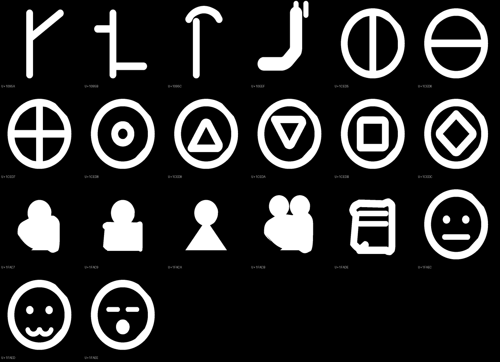
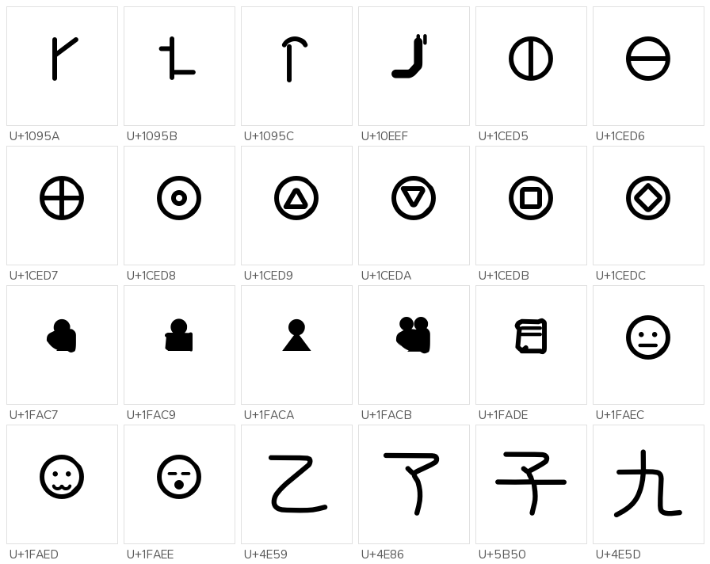
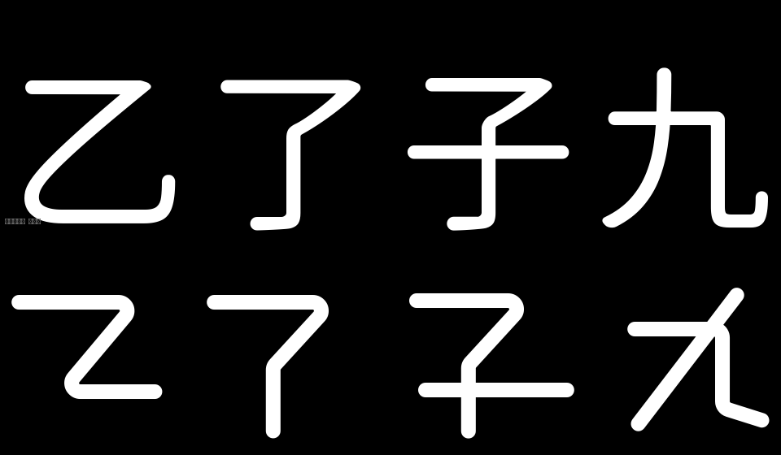

# 2026-10-26 覆盖补齐与二创四字

## 一、覆盖去哪了（实测）

主字体是文渊圆体 `WenYuanRoundedSCVF.ttf` v1.100（48,779,368 B），不是 Maruko。

| 对象 | 码位总数 | 主人贴的那批 |
|---|---|---|
| 文渊主字体 | 33,032 | **0 / 315** |
| 构建 `prune_blank_mappings` 后 | 33,032 → 33,032 | 剪掉 **0** |

文渊基底停在 Unicode 14 之前：连 U+11F00（Kawi）、U+1E030（西里尔修饰）都没有。
主人贴的 315 个码位里 298 个是 Unicode 15–18 新分配，17 个到 Unicode 18.0 仍未分配。

## 二、按上游做法补（不自己画）

上游 MakeFontsGreatAgain 的做法是投放分版本补充字件、由 fonts.xml 补字区兜底。
照此接进 `build.py` 的 `SUPPLEMENTAL_FONT_SOURCES`：

| 字件 | 来源 | 覆盖 |
|---|---|---|
| `Unicode18-new.ttf` | MFGA git blob `4314ad3`，OFL | 162 |
| `Unicode17-new.ttf` | MFGA git blob `e877906`，OFL | 29 |
| `NotoSansPro.otf` | MFGA git blob `a37c8e3`，OFL | 47 |
| `UnicodiaFunky.ttf` | Mercury13/unicodia，OFL | 69 |
| `NotoEmoji.ttf` | google/fonts，OFL | 85 |
| `Noto-COLRv1.ttf` | googlefonts/noto-emoji，OFL | 104 |

并集 **298 / 315**。余下 17 个码位在 Unicode 18.0 仍未分配，任何字库都没有标准字形。

## 二之二、20 个未分配码位自绘占位

「全字符覆盖」不能缺角，所以这 20 个按所在区块的风格自绘占位（`tools/reserved_glyphs.py`）：

| 码位 | 区块邻居 | 画法 |
|---|---|---|
| U+1CED5..U+1CEDC | 炼金术符号、叠层根号 | 环内加竖/横/十字/同心环/正三角/倒三角/方/菱 |
| U+1FAC7/C9/CA/CB | 人物与生物 emoji | 头 + 圆肩 / 方肩 / 三角身 / 双人 |
| U+1FADE | 腌菜、泼溅 | 带盖的罐 |
| U+1FAEC/ED/EE | 碎裂脸、打斗云 | 圆脸 + 平嘴 / 波浪嘴 / 张口 |
| U+10EEF | 阿拉伯冠字母 | 主干 + 下弯 + 冠符 |
| U+1095A..1095C | 帕尔米拉文字 | 该区块的竖干 + 斜臂笔形 |

主字体注入 20 个，补充字件并集 298 → **315 / 315，缺失 0**。

## 三、二创四字

不再修补原版轮廓，按规则生成（见 `tools/design_symbols.py`）：

- 笔宽 82（`HW_CJK=41`），取自文渊「一」的竖切实测；
- 字面 y 30..960、x 60..940，对齐文渊实测的 x 44..960 / y 162..999；
- 端头一律半径 41 标准半圆，折角为切线圆弧，内外双侧都圆。

上图为文渊原版（四字皆带钩），下图为二创（四字无钩）。

## 四、仍未做

- 二创只覆盖 4 字（乙了子九），`也/包/必/電` 等仍未重画。
- `子` 的斜撇与竖的转接处，比文渊原版更靠下一点，观感待主人判断。
