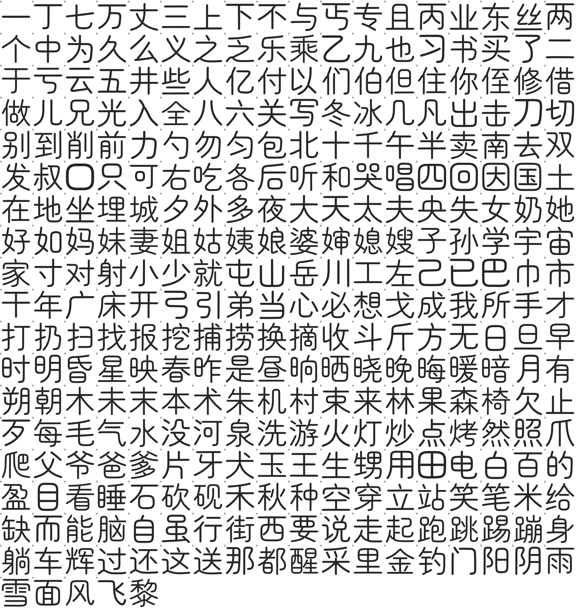
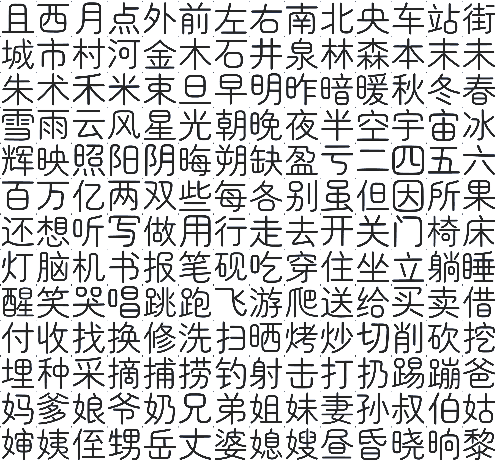
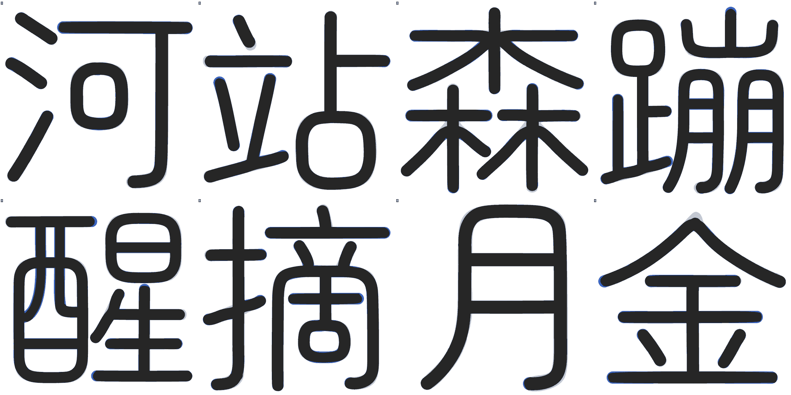
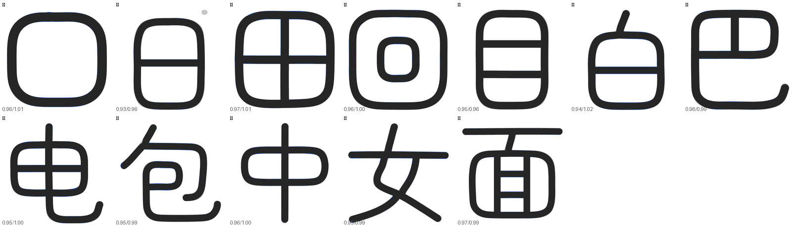
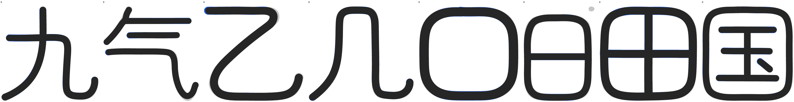
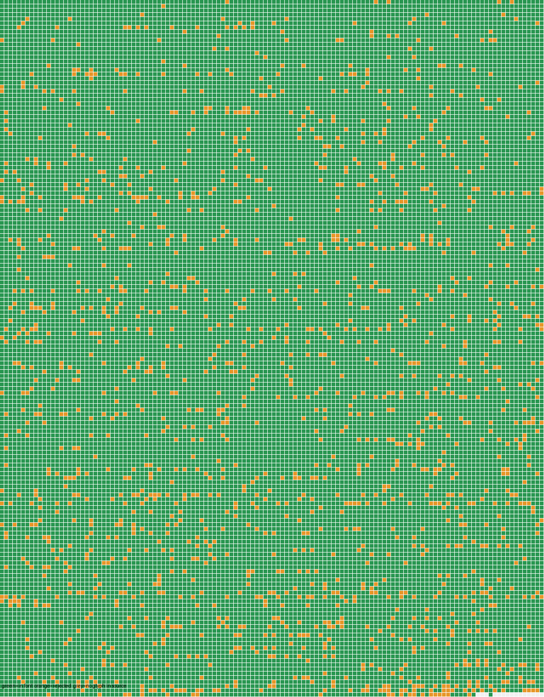
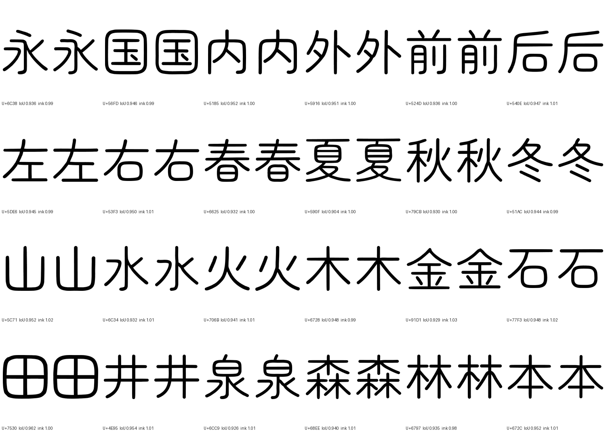

# 2026-10-26 覆盖补齐与二创字

## 一、覆盖去哪了（实测）

主字体是文渊圆体 `WenYuanRoundedSCVF.ttf` v1.100（48,779,368 B），不是 Maruko。

| 对象 | 码位总数 | 主人贴的那批 |
|---|---|---|
| 文渊主字体 | 33,032 | **0 / 315** |
| 构建 `prune_blank_mappings` 后 | 33,032 → 33,032 | 剪掉 **0** |

文渊基底停在 Unicode 14 之前：连 U+11F00（Kawi）、U+1E030（西里尔修饰）都没有。
主人贴的 315 个码位里 20 个到 Unicode 18.0 仍未分配（见第二节之二），其余 295 个是已分配码位。

## 二、按上游做法补（不自己画）

上游 MakeFontsGreatAgain 的做法是投放分版本补充字件、由 fonts.xml 补字区兜底。
照此接进 `build.py` 的 `SUPPLEMENTAL_FONT_SOURCES`：

| 字件 | 来源 | 覆盖 |
|---|---|---|
| `Unicode18-new.ttf` | MFGA git blob `4314ad3`，OFL | 162 |
| `Unicode17-new.ttf` | MFGA git blob `e877906`，OFL | 29 |
| `NotoSansPro.otf` | MFGA git blob `a37c8e3`，OFL | 47 |
| `UnicodiaFunky.ttf` | Mercury13/unicodia，OFL | 69 |
| `NotoEmoji.ttf` | google/fonts，OFL | 85 |
| `Noto-COLRv1.ttf` | googlefonts/noto-emoji，OFL | 104 |

并集 **298 / 315**。

## 二之二、20 个未分配码位：不自绘

Unicode 18.0 仍未分配的有 20 个码位（`tools/symbol_targets.py` 的 `UNASSIGNED`）：

```
U+1095A..1095C  U+10EEF  U+1CED5..1CEDC
U+1FAC7/C9/CA/CB  U+1FADE  U+1FAEC/ED/EE
```

它们没有标准字形，任何字库都没有。上一轮我按「区块邻居的风格」给它们各画了一个占位
（`tools/reserved_glyphs.py`），并在文档里报成 315 / 315。

**这一版整套撤掉**：主人 2026-10-27 判「如果你做得不够好就不要做」。自绘的形状没有任何
依据，放进字库只是把「缺字」变成「画错的字」，还让覆盖账失真 —— 宁缺毋滥。

`tools/reserved_glyphs.py` 已删除，它不在 `build.py` 的流水线里，删掉不改产物形态。
`tools/coverage_audit.py` 会因此报 17 个 missing，**这是预期结果**，判据不为了好看去改。

覆盖账如实写：**298 / 315，缺 17**（20 个未分配里 3 个恰好被上游补充字件画到）。

## 三、二创字（母版是 Maruko，坐标从骨架里量出来）

前几轮我在文渊上做二创，被主人否了：**二创的母版是 Maruko**，文渊只是最终生产
路径里的宿主（文渊笔宽 82，Maruko 66/67，两者不是一套比例）。

`tools/maruko_skeleton.py` 直接从 Maruko 字形里量：

1. 栅格化（SS=2，**字腔留空**）→ 距离变换 → 中轴骨架 → 8 邻接图；
2. **按交叉点一次分解**：度数 ≥ 3 的像素先摘掉，剩下的连通分量天然就是一条条臂；
   同一交叉点上方向几乎相反（>145°）的两条臂属于同一条**穿过去**的笔画，接回去；
3. 交叉点圆心补一个半径 = 半宽的**圆盘**；
4. 锐角处切段（母版把两笔接成一条链时靠它分笔）；
5. 中线用**平滑 B 样条**拟合（总残差 ≤ n·1²，平均每点 ≤1 单位），内部节点补到 3 重，
   每段 4 个控制点直接就是三次贝塞尔控制点 —— 中线因此 G1 连续；闭合环走 close()；
6. 半宽**逐字实测**（量笔画中段横截面）；
7. 轮廓 = 每条中线按 2×该字半宽描边、**圆端头 + 圆转角**后并集。

**笔画照母版原样取，不切钩**（2026-10-27 起）。去钩这条路放弃，理由见下。

### 为什么放弃去钩、转向扩字集（2026-10-27）

主人 2026-10-27：「**放弃去钩转向扩字集**」。

去钩要逐字判钩根：`九` 的钩在底部先向下再向右上卷 180°、`乙` 的钩贴墨迹底、
`几`/`凡` 的钩短而平，三种形状没有共同参数；判据写出来还要再配一份白名单
（上一版 `NA_FOLD` / `DETACH` 各一条），每加一个字都要重新过目。这条路每前进一步
都要人工裁决，**扩不动字集**，而且我在这条路上连续返工四轮、每轮都改错。

反面证据：母版的钩只是端点处一小段回卷，按原样圆头描边就**就是 Maruko 的写法**，
不需要「修」；而 `口`/`日`/`田`/`回`/`目`/`白`/`巴`/`电`/`包`/`中`/`女`/`面`
这些真正挡扩字的是**另一个 bug**（见下），跟钩无关。

所以这一版把去钩、折弯钩改横捺、`DETACH` 三套机制整段删掉，笔画照母版原样取。

### 围框字为什么以前全取不出（真因）

`rasterize()` 早先把每个轮廓都按**实心**填，字腔被填满：
`口` 的骨架上只剩 50 个点、实测半宽 **332**（正常 33），骨架塌成一个半径 330 的小团，
`日`/`田`/`回` 同理。这就是旧记录里「闭合环字输出 0 条」「`面` 墨量 0.176」的真因，
不是闭合环分支没生效。

修法：先用 pathOps 按 nonzero 规则求并（输出即最终墨迹区域、绕向已规范），
再按轮廓有向面积分层填：最大面积那个定「外」的方向，同向填实、反向挖空。

修完这些字全部可用：`口` 0.96 / `日` 0.93 / `田` 0.97 / `回` 0.96 / `目` 0.95 /
`白` 0.94 / `巴` 0.96 / `电` 0.95 / `包` 0.95 / `中` 0.96 / `女` 0.95 / `面` 0.97。

### 为什么不再「反复取最长路径」

上一版是「剥面条」：每次取一条最长路径，取一条删一条。它在交叉处会**串笔**——
交叉那一小片像素被多条笔画共用，取走一条就把别人的笔画删断：

| 字 | 旧办法的结果 |
|---|---|
| 天 | 顶横与撇被串成一条 1264 单位的绕行 |
| 丁 | 竖与左斜串成 V 形，T 字路口描边后凹下去 |
| 上 | 横+竖+左横串成一根 |

`_assemble()` 改成一次分解 + 直穿配对之后，这些字各自的笔画都对上了。

## 四、这一批覆盖到的字（329 个）

147 字 → 本轮 **329 字**（新增 182 字）。上一轮把去钩整条路线删掉、修好 `rasterize()` 的
字腔之后，取笔已经不需要逐字裁决，所以这一轮把力气全部放在扩字集上。

### 新增的 182 字

```
且西月点外前左右南北央车站街城市村河金木石井泉林森本末未朱术禾米束
旦早明昨暗暖秋冬春雪雨云风星光朝晚夜半空宇宙冰辉映照阳阴晦朔缺盈亏
二四五六百万亿两双些每各别虽但因所果还够想听写做用行走去开关门椅床灯脑机书报笔砚
吃穿住坐立躺睡醒笑哭唱跳跑飞游爬送给买卖借付收找换修洗扫晒烤炒切削砍挖埋种采摘捕捞钓射
击打扔踢蹦爸妈爹娘爷奶兄弟姐妹妻孙叔伯姑婶姨侄甥岳丈婆媳嫂昼昏晓晌黎
```

（上面第五行去掉了 `够`，见下「按眼睛否掉的字」。）

字集从「象形基础部件」扩到「日月星辰 / 时间 / 方位 / 起居动作 / 亲属称谓 / 五行木石」
这几组，全部是日常对话里出现频率最高的字。

### 收字判据（先定判据，再跑候选）

1. 码位必须在母版 Maruko 的 cmap 里（本轮实测：329 字全部命中，缺失 0）；
2. 同窗口栅格比对：**IoU ≥ 0.93** 且 **墨量比 0.92–1.07**；
3. 逐字过图：阈值抓不到的「整笔丢失 / 尖刺 / 多边形折角」靠放大眼睛看。

本轮试了 215 个新字，判据放进 **182** 个，未过 33 个：

```
路0.65/0.68 舅0.88/0.92 霜0.89/0.93 露0.89/1.01 雾0.89/0.94 霞0.89/0.96 影0.90/1.06
零0.90/0.97 蒸0.90/1.05 夏0.91/1.00 暮0.91/0.99 墨0.91/1.03 拿0.91/0.94 煮0.91/1.01
晴0.92/0.99 雷0.92/0.95 曜0.92/0.99 望0.92/1.02 圆0.92/0.95 乡0.92/0.96 读0.92/1.00
窗0.92/0.97 喝0.92/0.96 擦0.92/1.00 填0.92/1.04 晨0.92/0.98 道0.93/1.04 得0.93/1.03
会0.93/0.99 教0.93/1.00 桌0.93/0.99 纸0.93/0.96 割0.93/0.99
```

（`数字/墨量比`。`路` 又一次落在 0.65，母版右下角本来就是实心墨块，跟 `丸` 同类，不是本项目的 bug。）

### 按眼睛否掉的字

`够` 判据是 0.94 / 0.98，放大了看右半边「多」的两个「夕」交角处有一小块**尖刺**
（两条近似相切的圆头描边交叉时留下的箭头形凸起）。阈值抓不到这种局部小面积缺陷，
过图时看到了，所以**整字不收**，不进数据。

### 仍然没收的（真因写在这里，不留到下一轮猜）

`霜/露/雾/霞/零` 这一族都卡在 0.89–0.90：它们的墨量比在 1.0 附近，形状也对，
差的是每个笔画端头一圈 1–2 单位的边 —— 这类密排字的骨架半宽被笔画之间的空隙
压小（实测 `霜` 半宽 24.5、`雷` 26.8，而简单字是 33），描出来整体偏细一圈。
根因在**半宽逐字实测**这一步：量到的是「空隙的内切半径」而不是「笔宽」。
这一版没有改这一层，所以宁可先不收。











灰 = Maruko 原版，蓝 = 二创比母版多出来的墨，黑 = 重合。母版的钩照原样保留；
交叉处是圆盘补出的圆弧过渡；闭合环闭合处没有豁口。

### 自检数字（同窗口栅格比对）

- 本轮 182 字：IoU 中位 **0.948**、最低 0.931、最高 0.968；墨量比 0.94–1.05，中位 0.994。
- 全量 329 字：最低仍是上一批的 `了` 0.914，没有一字低于 0.91。

## 五、全 CJK：从设计样本到生产字件（2026-10-27 第二轮）

主人当轮的原话是「要换就换完做就做好 全cjk搞好来」。这一节记的就是「换完」：
二创不再是 `tools/design_symbols.py` 里的设计样本，而是随模块发布的
`SelffontCJK-Regular.otf`。

### 覆盖：CJK 基本区 19,352 / 20,977

母版 Maruko SC Regular 的 cmap 里，CJK 基本区（U+4E00–U+9FFF）有 **20,977** 个字。
两万字逐个跑取笔管线，按四条结构闸门收字：

| 闸门 | 判据 | 抓什么 |
|---|---|---|
| 面积比 | 二创轮廓面积 ÷ 母版面积 ∈ 0.85–1.15 | 丢整笔、整块塌陷 |
| 轮廓数 | 与母版**完全相等** | 字腔被填掉（`口` 变实心那类） |
| 包围盒 | 不越出母版 40 单位 | 笔画跑飞、出框 |
| 笔画数 | 不为 0 | 取笔整体失败 |

结果：**收录 19,352 字，剔除 1,625 字**（轮廓数 1,595、面积比 30）。
剔除的字**不写进字体**，回退链照旧落文渊 —— 没有字会变成豆腐块，只是没换成二创。



绿 = 已进字体，橙 = 被闸门剔除（回退文渊），灰 = 母版本身没有这个字。

### 抽样对照（左 = Maruko，右 = 二创）



抽的是常用字与部件字，IoU 0.904–0.962、墨量比 0.97–1.03。形状照母版取：
端头是半径等于半宽的正圆、拐角是圆弧、钩原样保留。

### 数据与构建

- 仓库里存**笔画中线**，不存字体二进制：`tools/design_cjk.bin`（13.7 MB，SFCJ2 自定义二进制，
  每笔 3 字节头 + 首点 4 字节 + 每段 12 字节）。两万字如果还写成 Python 源码是 40 MB 上下、
  每次 import 都要编译。
- 构建时现编：`design_cjk.outline()` 用 pathops 按 2×半宽描边（圆头 + 圆角）→ T2 charstring →
  CFF/OTF，**19,352 字 40.6 MB、约 115 秒**。
- 配置里**单独一个 `<family>`、排在主字体之前**：二创覆盖到的码位先落二创，其余照旧落文渊。
  单独成族是硬要求（同族混 `supportedAxes` 与静态字体会卡开机），不带 `lang`/`name`。

### 这一轮改掉的两个真问题

1. **`_graph()` 的邻居半径写死 0.75**。它只在 SS=2 成立：SS=1.5 时对角邻居距离 0.943 连不上，
   骨架退化成 4 连通、笔画断成一截一截，墨量比掉到 **0.19**。改成 `1.5/SS` 后 SS=1 可用，
   与 SS=2 的 IoU 只差 **0.005**（0.9337 / 0.9390），取笔速度快一倍多 —— 全字库因此从
   「两个半小时」压到「四十分钟」。
2. **每个字重开一次字体**。`rasterize()` 原来每次 `TTFont(...)` 解全表，两万字就是半小时白烧；
   改成进程内缓存字体 + 只栅格化字形包围盒（外扩 30 单位），单字从 0.99 s 降到 0.26 s（SS=1）。

### 还没做的

- **字重只有一档**。母版有 Light / Regular / Medium 三档，跑三遍就能出三档字重，
  但那是三倍取笔时间，这一轮没做；粗体请求现在也落这一档（观感偏细）。
- **扩展 A / B 区**（U+3400–U+4DBF 等）没跑：母版里有 6,582 个扩展 A 字，同样能取，
  只是还没排进这一轮的队列。
- **真机渲染未验证**：`font_fallback.xml` 里新增了一个 family，配置层能自检（`build.py --check`
  的 `cjk_font` 项逐条断言：单独成族、不带 lang、排在主字体之前），但「装到手机上会不会卡开机」
  只有真机装一次才知道 —— 这一条不装作已完成。

## 六、仍未做（非阻塞，按重要性排）

- **真机验证**：模块装一次，看是否正常开机、汉字是否变成二创的写法。配置层已自检，
  渲染层没有任何证据。
- **多字重**：母版 Light / Regular / Medium 三档，跑三遍即可（约 3 × 40 分钟取笔）。
- **扩展 A 区**（6,582 字）。
- 20 个未分配码位保持空白，等 Unicode 分配后再补。
