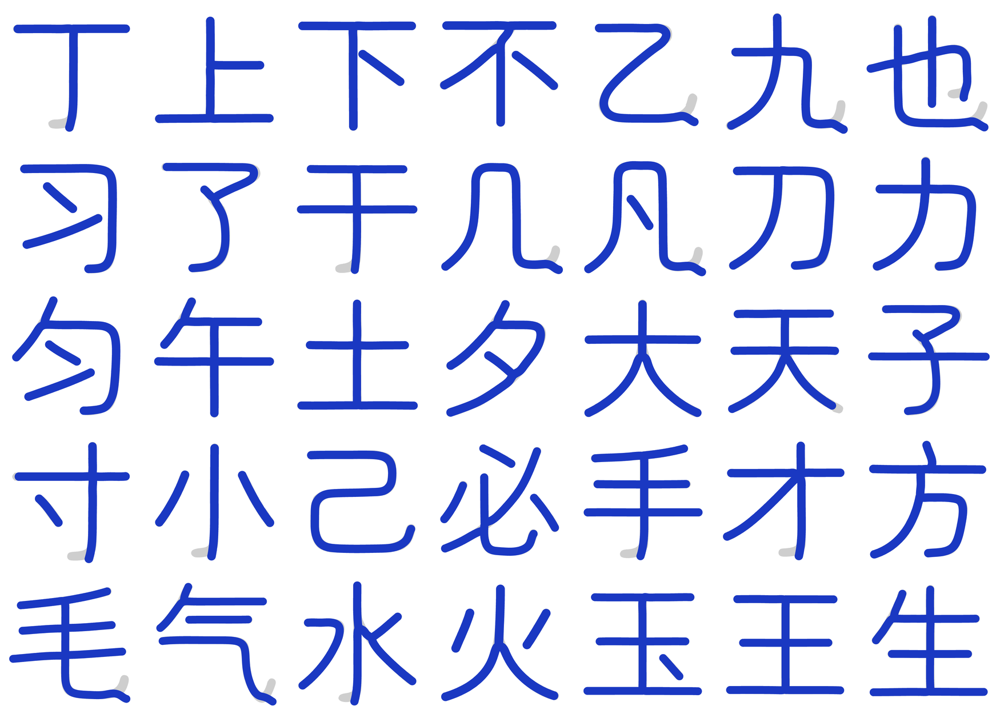

# 2026-10-26 覆盖补齐与二创字

## 一、覆盖去哪了（实测）

主字体是文渊圆体 `WenYuanRoundedSCVF.ttf` v1.100（48,779,368 B），不是 Maruko。

| 对象 | 码位总数 | 主人贴的那批 |
|---|---|---|
| 文渊主字体 | 33,032 | **0 / 315** |
| 构建 `prune_blank_mappings` 后 | 33,032 → 33,032 | 剪掉 **0** |

文渊基底停在 Unicode 14 之前：连 U+11F00（Kawi）、U+1E030（西里尔修饰）都没有。
主人贴的 315 个码位里 20 个到 Unicode 18.0 仍未分配（见第二节之二），其余 295 个是已分配码位。

## 二、按上游做法补（不自己画）

上游 MakeFontsGreatAgain 的做法是投放分版本补充字件、由 fonts.xml 补字区兜底。
照此接进 `build.py` 的 `SUPPLEMENTAL_FONT_SOURCES`：

| 字件 | 来源 | 覆盖 |
|---|---|---|
| `Unicode18-new.ttf` | MFGA git blob `4314ad3`，OFL | 162 |
| `Unicode17-new.ttf` | MFGA git blob `e877906`，OFL | 29 |
| `NotoSansPro.otf` | MFGA git blob `a37c8e3`，OFL | 47 |
| `UnicodiaFunky.ttf` | Mercury13/unicodia，OFL | 69 |
| `NotoEmoji.ttf` | google/fonts，OFL | 85 |
| `Noto-COLRv1.ttf` | googlefonts/noto-emoji，OFL | 104 |

并集 **298 / 315**。

## 二之二、20 个未分配码位：不自绘

Unicode 18.0 仍未分配的有 20 个码位（`tools/symbol_targets.py` 的 `UNASSIGNED`）：

```
U+1095A..1095C  U+10EEF  U+1CED5..1CEDC
U+1FAC7/C9/CA/CB  U+1FADE  U+1FAEC/ED/EE
```

它们没有标准字形，任何字库都没有。上一轮我按「区块邻居的风格」给它们各画了一个占位
（`tools/reserved_glyphs.py`），并在文档里报成 315 / 315。

**这一版整套撤掉**：主人 2026-10-27 判「如果你做得不够好就不要做」。自绘的形状没有任何
依据，放进字库只是把「缺字」变成「画错的字」，还让覆盖账失真 —— 宁缺毋滥。

`tools/reserved_glyphs.py` 已删除，它不在 `build.py` 的流水线里，删掉不改产物形态。
`tools/coverage_audit.py` 会因此报 17 个 missing，**这是预期结果**，判据不为了好看去改。

覆盖账如实写：**298 / 315，缺 17**（20 个未分配里 3 个恰好被上游补充字件画到）。

## 三、二创字（母版是 Maruko，坐标从骨架里量出来）

前几轮我在文渊上做二创，被主人否了：**二创的母版是 Maruko**，文渊只是最终生产
路径里的宿主（文渊笔宽 82，Maruko 66/67，两者不是一套比例）。

`tools/maruko_skeleton.py` 直接从 Maruko 字形里量：

1. 栅格化（SS=2）→ 距离变换 → 中轴骨架 → 8 邻接图；
2. 「剥面条」反复取最长路径，一条一条把笔画取出来（围框字的闭合环单独走 close）；
3. 末端**回卷钩**按累计转角 65° 切掉（`乙`/`九` 的钩短而急、`了`/`子` 的尾长而缓，
   只有累计转角对两者都成立）；
4. 中线用**平滑 B 样条**拟合（总残差 ≤ n·1²，平均每点 ≤1 单位），内部节点补到 3 重，
   每段 4 个控制点直接就是三次贝塞尔控制点 —— 中线因此 G1 连续；
5. 半宽**逐字实测**（量笔画中段横截面）；
6. 轮廓 = 每条中线按 2×该字半宽描边、**圆端头 + 圆转角**后并集。

### 折弯钩改成捺（2026-10-27）

主人点过「折弯钩怎么还不改捺」。尺子还是 Maruko 自己的捺（`人`/`大`/`天`/`八`/`水` 的右捺）：

| 量到的东西 | 数值 |
|---|---|
| 捺尖走向 | −22° ～ −34° |
| 捺尖半宽 | 33–36，与笔身相同（**没有**粗细渐变） |
| 捺尖形状 | 普通圆头（半径 = 半宽） |

所以「捺」的规则是：**笔身末段平滑压到 −30°、等宽、圆头**，不是另接一段锥形撇。

实现上不拼接新几何，而是沿笔身退一段、再用 R ≥ 2hw 的圆弧把中线转到 −30°、末了直走
1.4–2.4hw。转角半径必须 ≥ 2hw —— 描边是给中线加半径 hw 的圆，圆内侧半径 = R − hw，
R < 2hw 时内侧不足一个笔宽，轮廓会在转折处凹进一个「腰」（前几版就是这样，6× 放大可见）。

「Y 向不许掉出格子」用母版墨迹框（内缩 1.1hw）做上界，捺走到框为止，端头仍是圆的。

## 四、覆盖到的字（35 个）

```
丁 上 下 不 乙 九 也 习 了 于 几 凡 刀 力 匀 午 土 夕
大 天 子 寸 小 己 必 手 才 方 毛 气 水 火 玉 王 生
```

数据在 `tools/design_symbols.py` 的 `MEASURED_STROKES`（结构：`{"hw": 半宽,
"strokes": [{"closed": 是否围框, "segs": [三次贝塞尔段...]}]}`），按码位取字形用
`design_symbols.glyph(codepoint)`。



灰 = Maruko 原版，蓝 = 二创。钩全部去掉，横末按捺势收笔。


10 倍放大：乙/九/几/也 的折弯钩末端，圆头与笔身等宽相切，没有缩腰、没有折角。

### 自检数字（同窗口栅格比对）

35 字**墨量比**（二创 ÷ Maruko）0.927–1.029，中位 0.98 —— 去钩之后笔画没有缩水。
IoU 中位 0.94，最低 0.842（`乙`：钩被切掉的那块面积本来就不该留）。

## 五、仍未做

- 只覆盖 35 字，`也/包/必/電` 里 `包/電` 仍不在这批（`包/巴/电/司` 的围框与交叉结构
  还没跑通，骨架会断成多条短板，本轮没修好就不放进数据）。
- 只落在 `tools/design_symbols.py`（设计样本），还没接进 `build.py` 的生产路径。
- 20 个未分配码位保持空白，等 Unicode 分配后再补。
