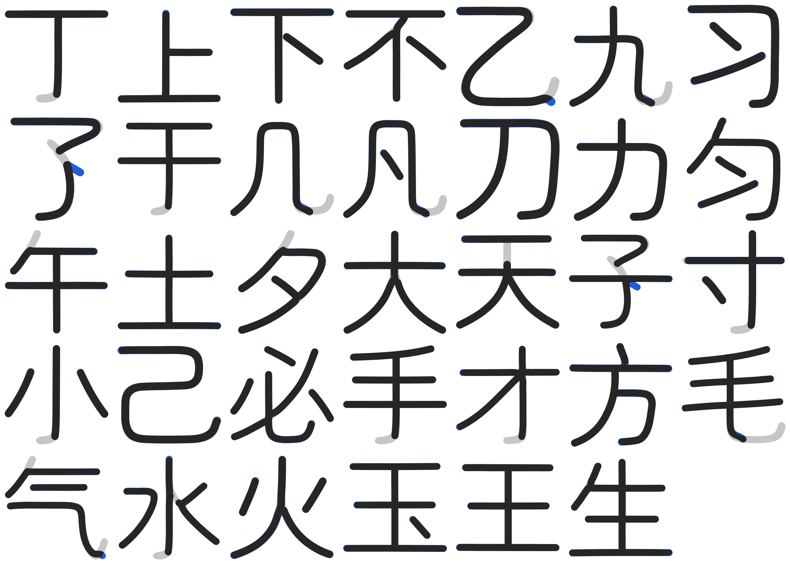
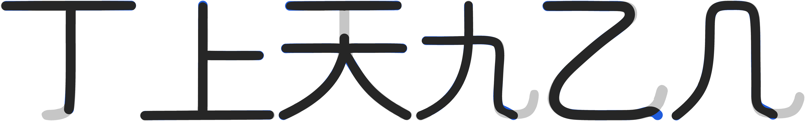

# 2026-10-26 覆盖补齐与二创字

## 一、覆盖去哪了（实测）

主字体是文渊圆体 `WenYuanRoundedSCVF.ttf` v1.100（48,779,368 B），不是 Maruko。

| 对象 | 码位总数 | 主人贴的那批 |
|---|---|---|
| 文渊主字体 | 33,032 | **0 / 315** |
| 构建 `prune_blank_mappings` 后 | 33,032 → 33,032 | 剪掉 **0** |

文渊基底停在 Unicode 14 之前：连 U+11F00（Kawi）、U+1E030（西里尔修饰）都没有。
主人贴的 315 个码位里 20 个到 Unicode 18.0 仍未分配（见第二节之二），其余 295 个是已分配码位。

## 二、按上游做法补（不自己画）

上游 MakeFontsGreatAgain 的做法是投放分版本补充字件、由 fonts.xml 补字区兜底。
照此接进 `build.py` 的 `SUPPLEMENTAL_FONT_SOURCES`：

| 字件 | 来源 | 覆盖 |
|---|---|---|
| `Unicode18-new.ttf` | MFGA git blob `4314ad3`，OFL | 162 |
| `Unicode17-new.ttf` | MFGA git blob `e877906`，OFL | 29 |
| `NotoSansPro.otf` | MFGA git blob `a37c8e3`，OFL | 47 |
| `UnicodiaFunky.ttf` | Mercury13/unicodia，OFL | 69 |
| `NotoEmoji.ttf` | google/fonts，OFL | 85 |
| `Noto-COLRv1.ttf` | googlefonts/noto-emoji，OFL | 104 |

并集 **298 / 315**。

## 二之二、20 个未分配码位：不自绘

Unicode 18.0 仍未分配的有 20 个码位（`tools/symbol_targets.py` 的 `UNASSIGNED`）：

```
U+1095A..1095C  U+10EEF  U+1CED5..1CEDC
U+1FAC7/C9/CA/CB  U+1FADE  U+1FAEC/ED/EE
```

它们没有标准字形，任何字库都没有。上一轮我按「区块邻居的风格」给它们各画了一个占位
（`tools/reserved_glyphs.py`），并在文档里报成 315 / 315。

**这一版整套撤掉**：主人 2026-10-27 判「如果你做得不够好就不要做」。自绘的形状没有任何
依据，放进字库只是把「缺字」变成「画错的字」，还让覆盖账失真 —— 宁缺毋滥。

`tools/reserved_glyphs.py` 已删除，它不在 `build.py` 的流水线里，删掉不改产物形态。
`tools/coverage_audit.py` 会因此报 17 个 missing，**这是预期结果**，判据不为了好看去改。

覆盖账如实写：**298 / 315，缺 17**（20 个未分配里 3 个恰好被上游补充字件画到）。

## 三、二创字（母版是 Maruko，坐标从骨架里量出来）

前几轮我在文渊上做二创，被主人否了：**二创的母版是 Maruko**，文渊只是最终生产
路径里的宿主（文渊笔宽 82，Maruko 66/67，两者不是一套比例）。

`tools/maruko_skeleton.py` 直接从 Maruko 字形里量：

1. 栅格化（SS=2）→ 距离变换 → 中轴骨架 → 8 邻接图；
2. **按交叉点一次分解**：度数 ≥ 3 的像素先摘掉，剩下的连通分量天然就是一条条臂；
   同一交叉点上方向几乎相反（>145°）的两条臂属于同一条**穿过去**的笔画，接回去；
3. 交叉点圆心补一个半径 = 半宽的**圆盘**；
4. 末端回卷钩按累计转角 65° 切掉；
5. 中线用**平滑 B 样条**拟合（总残差 ≤ n·1²，平均每点 ≤1 单位），内部节点补到 3 重，
   每段 4 个控制点直接就是三次贝塞尔控制点 —— 中线因此 G1 连续；
6. 半宽**逐字实测**（量笔画中段横截面）；
7. 轮廓 = 每条中线按 2×该字半宽描边、**圆端头 + 圆转角**后并集。

### 为什么不再「反复取最长路径」

上一版是「剥面条」：每次取一条最长路径，取一条删一条。它在交叉处会**串笔**——
交叉那一小片像素被多条笔画共用，取走一条就把别人的笔画删断。实测：

| 字 | 旧办法的结果 |
|---|---|
| 天 | 顶横与撇被串成一条 1264 单位的绕行，二创因此没有顶横、撇从左上角挑起 |
| 丁 | 竖与左斜串成 V 形，T 字路口描边后凹下去 |
| 上 | 横+竖+左横串成一根 |
| 九 | 捺被并进竖钩，量到的「捺」其实是母版的钩尾 |

`_assemble()` 改成一次分解 + 直穿配对，这四个字各自的笔画就都对上了（`天` 5 条链 →
顶横 / 撇 / 中横 / 捺 / 碎片；`丁` 2 条；`上` 3 条；`九` 2 条）。

### `天` 的顶横要独立

Maruko 的「天」把撇的起笔从顶横中点垂下来接住顶横（母版设计如此，像素实测两横之间
有一段 60 单位宽的竖）。主人要求顶横独立、平，所以在 `DETACH` 表里显式切断，
撇从中横上沿起笔（穿过中横，是「天」的本形）。

### 折弯钩改成捺（2026-10-27）

主人点过「折弯钩怎么还不改捺」。做法分两步：

1. **切到钩根**：`trim_end()` 按累计转角 65° 只削掉钩前面那一截，`九` 的钩在底部
   会先向下再向右上卷 180°，切完剩下的末段方向已经是 (0.87, −0.5)，再按捺势转 60°
   就走成了**月牙**（上一版被主人判「折下去什么意思」）。所以再加 `_cut_leg()`：
   从末端往回走到出现连续竖直笔身的地方（要求这段竖直 ≥ 4×半笔宽，且距末端 ≤ 20×
   半笔宽）才算钩根。
2. **接捺**：从切口沿 −30° 直走一截，长度到母版墨迹框（内缩 1.1hw）为止，端头圆头。

之所以不用「R = 2hw 的圆弧把中线转过去」：圆弧要占掉两个半笔宽，而 `乙`/`九` 的钩
就在墨迹底边，根本没有那个空间，一转身就掉到框外（实测 `乙` 捺尖到 y = −101，
母版墨迹底是 −16）。直尾只占一个长度，转折交给描边的 round join 和样条本身去圆。

尺子还是 Maruko 自己的捺（`人`/`大`/`天`/`八`/`水` 的右捺）：捺尖走向 −22° ～ −34°，
取 −30°；捺尖半宽与笔身相同（**没有**粗细渐变），所以是等宽圆头，不做锥形。

## 四、覆盖到的字（34 个）

```
丁 上 下 不 乙 九 习 了 于 几 凡 刀 力 匀 午 土 夕
大 天 子 寸 小 己 必 手 才 方 毛 气 水 火 玉 王 生
```

`也` 本轮**移出**：它的最后一笔是「乚」（竖—弯—横），横段占整条笔画的六成，
按折弯钩去切会把笔画砍成一根斜线（实测 IoU 0.84 但字形已经不对）。做不好就不放。

数据在 `tools/design_symbols.py` 的 `MEASURED_STROKES`（结构：`{"hw": 半宽,
"strokes": [{"closed": 是否围框, "segs": [三次贝塞尔段...]}]}`；交叉点的圆盘用
零长度段表示，描边后就是一个半径 = 半宽的圆），按码位取字形用 `design_symbols.glyph(codepoint)`。



灰 = Maruko 原版，蓝 = 二创，黑 = 重合。钩全部去掉，折弯钩的收笔是捺。



4 倍放大：`丁`/`上` 的 T 字路口是圆弧过渡（圆盘补的），`天` 顶横与撇之间是断开的，
`九`/`乙`/`几` 的折弯钩收笔逐字变成 −30° 的捺。

### 自检数字（同窗口栅格比对）

34 字**墨量比**（二创 ÷ Maruko）0.83–1.04，中位 0.94；IoU 中位 0.914，最低 0.794（`了`）。
低的那几个都是「钩被切掉的那块面积本来就不该留」：`了` 0.79、`毛` 0.83、`九`/`几` 0.84、
`乙`/`气` 0.86、`凡`/`丁` 0.87。

## 五、仍未做

- 只覆盖 34 字，`包/電` 仍不在这批（`包/巴/电/司` 的围框与交叉结构
  还没跑通，骨架会断成多条短板，本轮没修好就不放进数据）。
- 只落在 `tools/design_symbols.py`（设计样本），还没接进 `build.py` 的生产路径。
- 20 个未分配码位保持空白，等 Unicode 分配后再补。
